<h1 align="center">rCAD</h1>

  <b>Parametric CAD, CAM, FEA and electronics in one native desktop app, written in Rust.</b> 
  Model a part, assemble it, draw it, machine it, stress it, design its circuit board and run its firmware,
  all in the same document.

  
  
  
  

  <picture>
    <source media="(prefers-color-scheme: dark)" srcset="docs/screenshots/robot-arm-dark.png">
    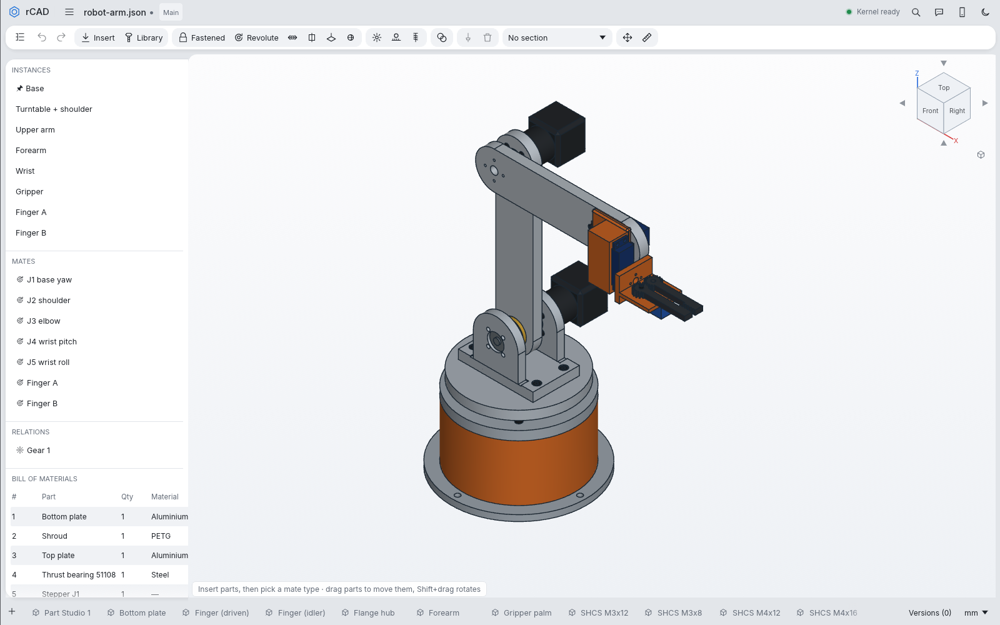
  </picture>

rCAD works the way Onshape does: a document holds tabs for Part Studios, Assemblies and Drawings,
and next to them Manufacture (CAM), Simulation (FEA) and PCB tabs that all work from the same parts.
It is built on egui/eframe with a wgpu viewport and the [OpenCascade](https://dev.opencascade.org/)
(OCCT 7.8) kernel, which runs in its own process so a failing operation can't take the editor down.

**Contents:** [Features](#features) ·
[Robot arm example](#the-robot-arm-example) ·
[Automation](#automation-claude-mcp-scripting-python) ·
[Install](#install) · [Controls](#controls) · [Source layout](#source-layout) · [License](#license)

## Features

### Part Studio

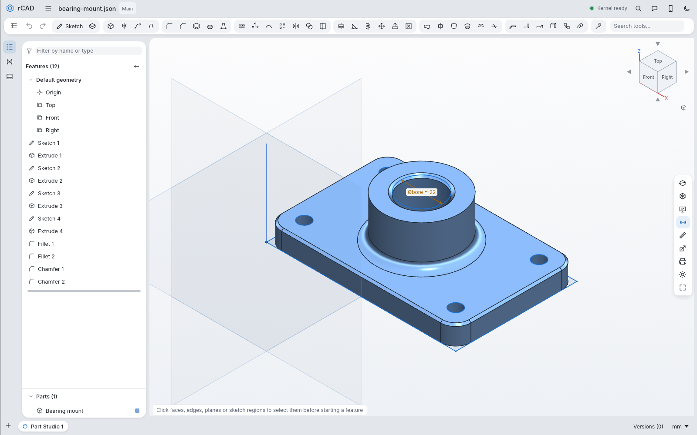

Sketch with a constraint solver and driving dimensions that take expressions and variables, then
build the part from features with a rollback bar, configurations, materials and mass properties.

Everything in the Part Studio

- **Sketch tools:** line, rectangles, circle, arcs, tangent arc, slot, polygon, ellipse, spline, text and
  point; trim, extend, sketch fillet, offset, mirror, project, sketch patterns, construction geometry,
  and DXF and SVG import.
- **Constraints:** coincident, horizontal, vertical, parallel, perpendicular, tangent, equal, midpoint,
  concentric, fix and symmetric, plus driving dimensions.
- **Features:** extrude (blind, symmetric, through all, up to face, second direction,
  add/remove/intersect), revolve, sweep (including along a helix), loft, fillet (constant or variable),
  chamfer, shell, hole (simple, counterbore, countersink, ISO sizes), draft, thicken, rib, move face,
  delete face, helix, planes (offset, angle, 3 points, normal to curve, mid plane), linear and circular
  patterns and mirror of parts or features, boolean, split, transform/copy, delete body, sheet metal
  (bent profile or plate, K-factor flat pattern DXF), and STEP/Parasolid (.x_t)/IGES import.
- **Around them:** variables and configurations, rollback bar, suppress and hide, part names,
  colours, materials and mass properties, raw stock sizes (the smallest standard plate, bar or
  round bar a part fits in, shown in the BOM, the title block and as a CAM stock preset),
  measure, section view and X-ray.
- **Command search** like Fusion 360: press S (or / or Ctrl+K while sketching) to find and run any
  command by name.

### Assemblies and standard parts

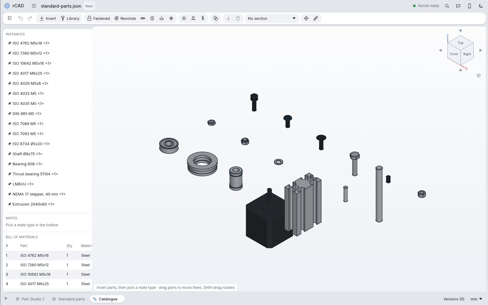

Insert parts and join them with fastened, revolute, slider, cylindrical, planar and ball mates; drag
them to see the mechanism move, explode it, section it and export the bill of materials. Gear, rack
and screw relations carry motion from one mate to another.

The **Library** inserts parametric standard parts: ISO/DIN socket, button, countersunk, hex and set
screws; hex, thin and nyloc nuts; washers; dowel pins and shafts; ball, thrust and linear bearings;
NEMA 8–23 steppers; and 2020–4080 T-slot extrusions. For anything else, its **GrabCAD** tab opens a
search in your browser, and the STEP or ZIP you download goes in from the recent downloads list or by
dropping it on the window.

### Drawings

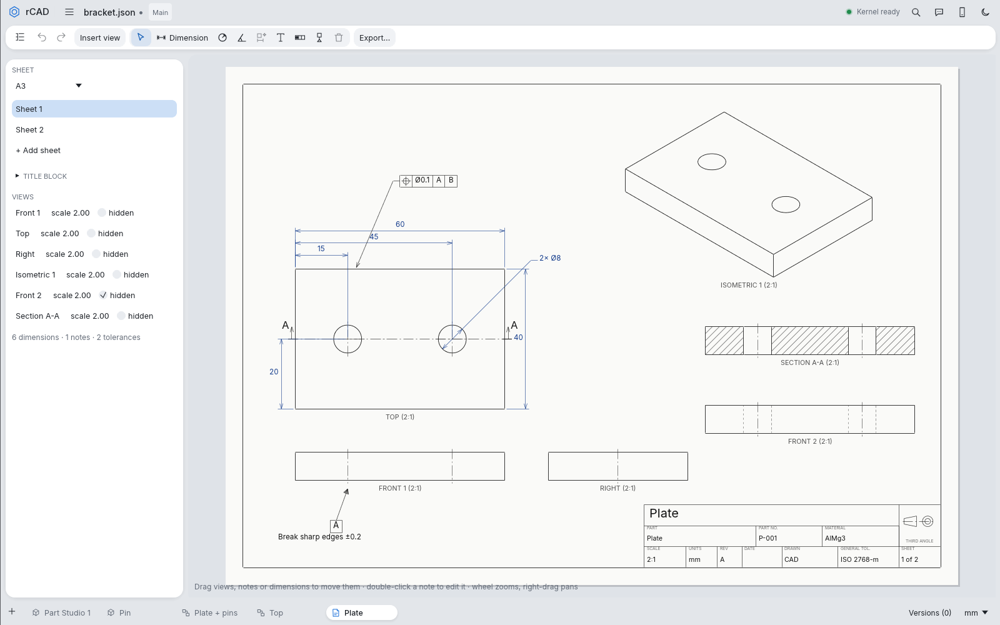

Hidden-line projected views in a standard layout, section views with hatching, detail views,
dimensions, notes, tolerances, a BOM table and a title block, exported to PDF, DXF or SVG.

### Manufacture (CAM)

<table>
  <tr>
    <td width="50%">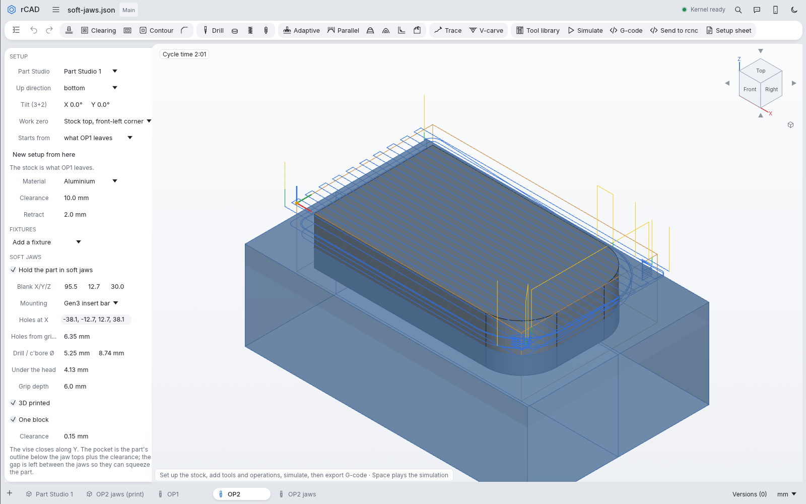</td>
    <td width="50%">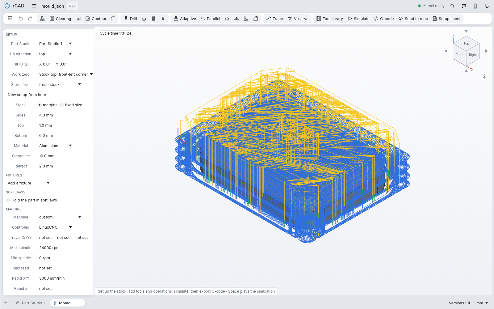</td>
  </tr>
  <tr>
    <td>Flip the part into <b>automatic soft jaws</b>: a pocket shaped to the part, machined in a tab of its own or 3D printed, with screw holes for Gen3 insert bars or top jaws.</td>
    <td><b>3D toolpaths</b>: adaptive clearing with cycloidal loops, parallel, waterline, scallop, pencil and deburr, plus rest machining of what earlier operations left.</td>
  </tr>
</table>

Set up the stock and work zero, pick tools from a library of about 80 presets (or import a Fusion 360
library), add operations with feeds and speeds suggested for your spindle, simulate the result with
crash detection, and post G-code for GRBL, LinuxCNC, Fanuc, Mach3 or rcnc.

Everything in the Manufacture tab

- **Work tree:** every setup in the document, and under the open one its stock, work zero,
  fixtures, machine, tools and operations, each with what it is set to. Pick a node to edit it in
  the panel below the tree (drag the bar between them to resize); the simulation's results sit on a
  card of their own over the view.
- **Setups:** orientation, 3+2 tilts for angle blocks and compound-angle features, stock, work zero,
  material and the spindle's speed range; multiple setups that flip the part and carry on from the
  leftover stock.
- **Tools:** flat, ball, bull nose, tapered ball, chamfer, slot, V-bits, face mills, drills, spot and
  centre drills, reamers, thread mills and taps, with holder outlines (ER collets, shrink-fit,
  side-lock). Your own tools, and Fusion 360 libraries (.json or .tools).
- **2.5D operations:** face, clearing, pocket, contour with tabs and arc leads, chamfer, drill/peck,
  bore, thread mill and tap (also in a self-reversing tapping head).
- **3D operations:** adaptive clearing with cycloidal loops, parallel, waterline, scallop, pencil
  clean-up of corners a bigger tool left, and deburr/3D chamfer of picked or all sharp edges.
- **Engraving:** trace and V-carve along sketch curves, for lines, text and logos.
- **Fixtures and soft jaws:** clamps, vise jaws and screws that toolpaths lift over. Soft jaws get a
  pocket with clearance and corner reliefs, a tab that machines them or a Part Studio of 3D printable
  jaws (or a one-piece printed block) to export as STEP, screw holes for the vise, and a check that
  the flipped part fits.
- **Machines:** presets with travel, feed and tool-changer limits, your own machine saved for new
  setups, and setup coolant that tools inherit.
- **Simulation:** a stock simulator that colours each operation's cuts and catches rapids into stock,
  shank and holder collisions, fixture hits and gouges.
- **Output:** G-code with G2/G3 arcs (including helices), tool probing after a change, your own start,
  tool-change and end code, operation templates, printable setup sheets, and **Send to rcnc**, which
  loads the program, its tools and its setup sheet straight into the controller.

### Simulation (FEA)

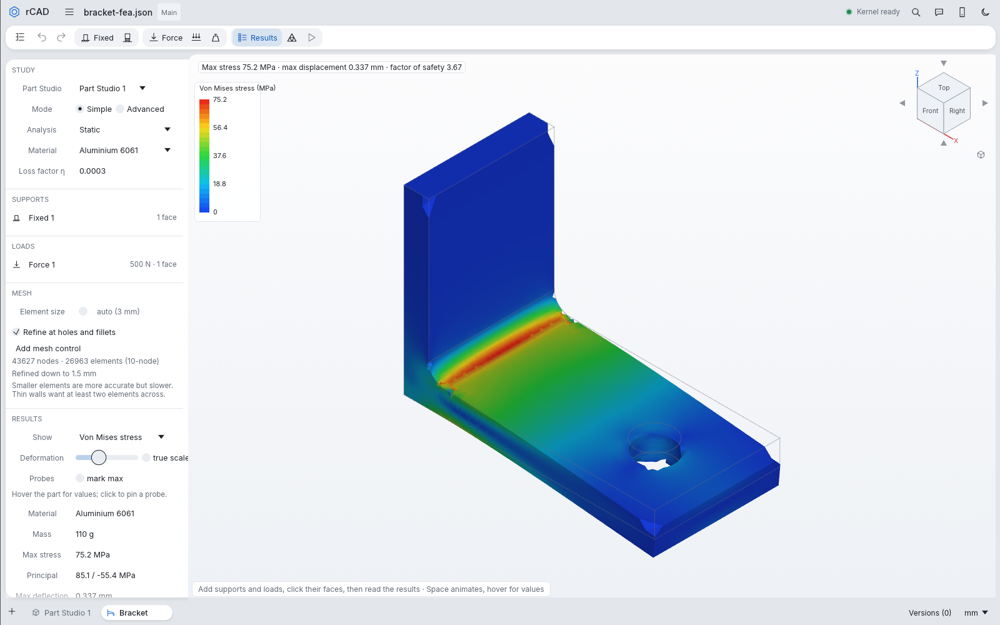

Linear elastic analysis of a Part Studio's parts with automatic 10-node tetrahedral meshing, refined
at holes and fillets or by your own mesh controls. Pick supports and loads on faces and run:

- **Static:** von Mises stress, deflection, factor of safety and reaction forces.
- **Modal:** natural frequencies, mode shapes and effective mass, free-free when nothing holds the part.
- **Transient:** step, ramp, impact or shaking loads with damping.

Parts of different materials are bonded where they touch, material loss factors give each mode's
damping and ring-down time, and results show as colour maps on the deformed shape with probes and
animation. **Advanced** mode runs the crackh3d finite element solver with periodic boundary pairs for
unit cells.

### PCB design

<table>
  <tr>
    <td width="50%">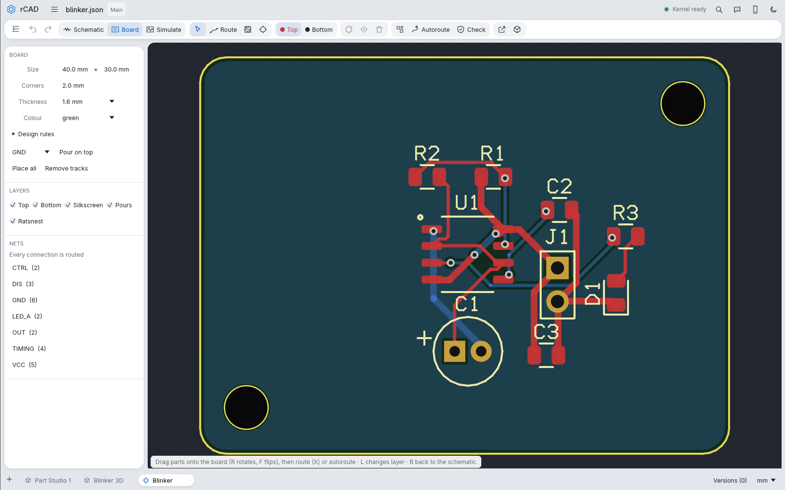</td>
    <td width="50%">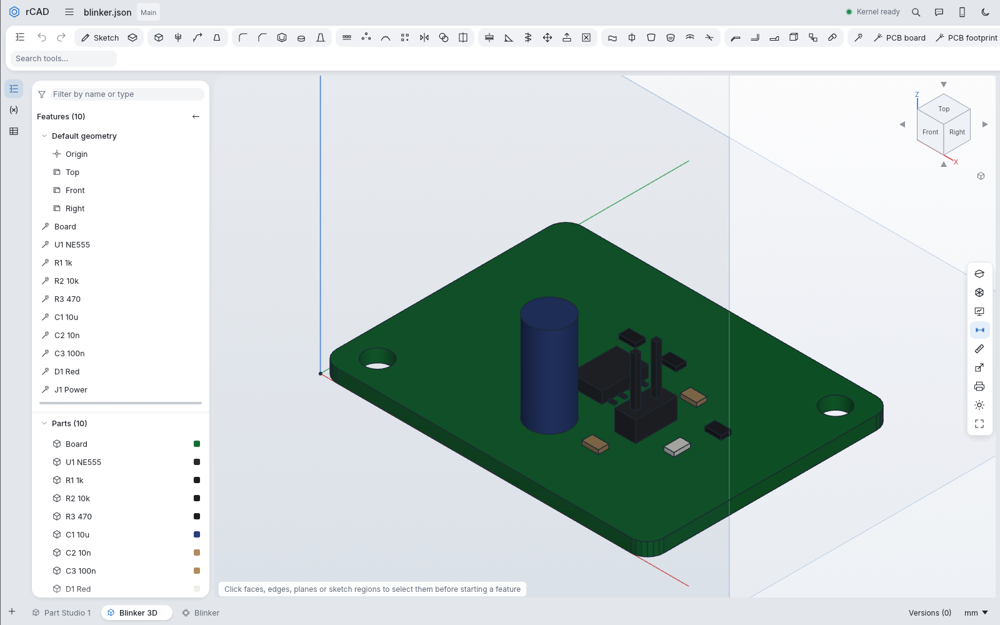</td>
  </tr>
</table>

A PCB tab holds a schematic and a two-layer board that share the same parts. Wire symbols from the
library, name nets with labels and power ports, then place footprints by hand or automatically and
route them with 45° tracks and vias or with the autorouter. Copper pours, a ratsnest and a design
rule check are there, and the output is a Gerber and Excellon ZIP for board makers such as JLCPCB,
BOM and pick-and-place CSVs, and a **3D board** Part Studio to put in your assemblies or export as STEP.

### Circuit and firmware simulation

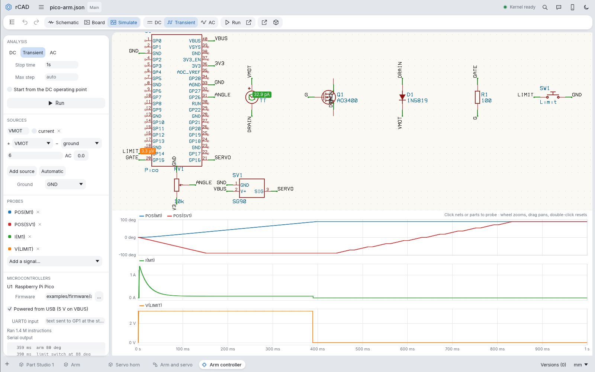

The PCB tab's **Simulate** view runs the schematic as a SPICE-style circuit: a DC operating point, a
transient from power-on and an AC sweep, with models for common resistors, capacitors, diodes, LEDs,
transistors, MOSFETs, 555 timers, op amps and regulators taken from the part values.

- **Firmware:** a Raspberry Pi Pico in the schematic runs its real firmware (UF2, ELF, HEX or BIN from
  the Pico SDK or Arduino-Pico) on an emulated RP2040: both cores, GPIO, timers, PWM, the ADC, the
  UARTs and the watchdog. It reads the circuit's voltages and drives its pins back into it, and the
  serial output appears with timestamps.
- **Mechanisms:** link a DC motor, a stepper on an A4988, DRV8825 or TMC2209 driver, a servo, a
  potentiometer, a limit switch or an encoder to a mate of an assembly. The motors turn their mates
  against the load, the sensors read them back, and **Play** shows the assembly moving as it did in
  the run. In the screenshot, `examples/pico-arm.json` drives an arm until its limit switch trips,
  then sweeps a servo.

### Design with Claude

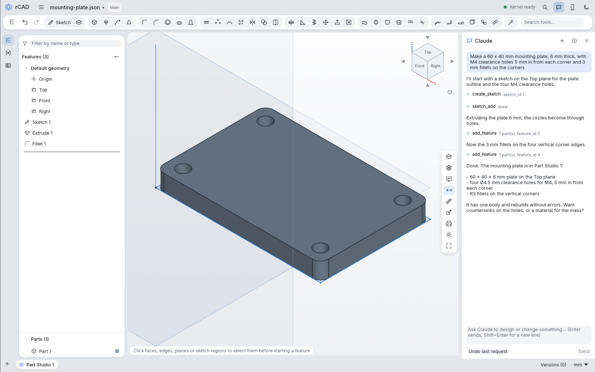

Press Ctrl+L (or the chat button in the header) and describe a part or a change in plain language.
Claude builds it in the open document with the same tools as the MCP server and checks its work with
renders, and each request can be undone from the panel. It connects through the Claude Code CLI on
your computer (so requests use your Claude plan), an Anthropic API key, or a Claude Console account
signed in with the `ant` CLI. A key is kept in `~/.config/cad-rust-app/claude.json`, readable only by you.

## The robot arm example

The arm at the top of this page is a full design done in rCAD: a 5-axis desktop arm with a
gear-coupled gripper, built by [`examples/robot-arm/parts.rhai`](examples/robot-arm/README.md). Its
plates and links are machined from 6061 in two or three setups (the second sides held in printed soft
jaws), the yoke and links were checked with FEA, the cover and gripper are printed in PETG, and the
Pico controller firmware homes the steppers and runs a pick-and-place cycle in the circuit simulator.

    mkdir out && rcad script examples/robot-arm/parts.rhai out

## Automation: Claude, MCP, scripting, Python

- **MCP server:** `rcad mcp` gives Claude Code (or any MCP client) tools for every part of the app,
  from sketches to toolpaths, FEA and PCBs. Add it with
  `claude mcp add --scope user rcad -- rcad mcp`, or use the repository's `.mcp.json`. See [AGENTS.md](AGENTS.md).
- **Tool scripts:** `rcad run script.json` runs a list of those tool calls with no window. Every file in
  [`examples/`](examples) is one, from a bracket with a PDF drawing to a CAM plate, an FEA bracket and
  the 555 blinker board.
- **Rhai scripting:** `rcad script file.rhai` runs a script on the same kernel: shapes, 2D regions and
  offsets, booleans, fillets on chosen edges, mass properties, ray casting and renders. See
  [SCRIPTING.md](SCRIPTING.md); [`examples/zerotorque/`](examples/zerotorque) builds a putter head,
  then machines and analyses it.
- **Python:** [`python/`](python/README.md) builds `cadrust`, bindings with a FreeCAD-style API,
  offscreen renders, STEP assemblies and finite elements.
- **Export:** STEP, IGES, STL, OBJ, PNG, G-code, and an interactive web page of an assembly whose
  slider and revolute mates move within their limits.

## Install

Download a build for Linux or Windows from
[Releases](https://github.com/JonasMerrell/cad-rust-app/releases) (`rcad-<platform>`), unpack it and run
`rcad`. The archive also has `AGENTS.md`, `SCRIPTING.md`, `.mcp.json` and the examples.

Or build from source:

    cargo build --release        # the first build compiles OpenCascade (about 20 minutes)
    ./target/release/rcad [part.json]

`rcad --help` lists the command line modes and `rcad --version` prints the version. Settings, tools
and templates live in `~/.config/cad-rust-app/`.

## Controls

| | |
|---|---|
| Orbit / pan / zoom | right-drag / middle-drag or Shift+right-drag / wheel at the cursor |
| Start a feature | Shift+S sketch, Shift+E extrude, Shift+R revolve, Shift+F fillet, Shift+H hole |
| Views | 0–3, F to fit |
| General | M measure, S command search, Ctrl+L Claude, Ctrl+Z / Ctrl+Shift+Z undo/redo, Ctrl+S save |
| Sketch tools | L line, R rectangle, C circle, A arc, P point, D dimension, K trim, O offset, U project, Q construction, G grid snap, N normal-to |
| Sketch constraints | with a selection, I/H/V/T/E/M/X; Enter finishes, Esc steps back |

## Source layout

Where things are in <code>src/</code>

| file | what |
|---|---|
| `src/app.rs` | app state, toolbar, feature tree, variables, status bar, undo/redo, files |
| `src/workspace.rs` | the document's tabs: Part Studios, Assemblies, Drawings, Manufacture, Simulation and PCB |
| `src/home.rs` | the start screen with recent documents |
| `src/theme.rs` | colours, fonts and the card style of the panels |
| `src/viewport.rs` | navigation, scene assembly, picking, measure, overlays |
| `src/render.rs` | wgpu pipelines (shaded meshes, thick lines, points, section clipping) |
| `src/sketcher.rs` | sketch mode tools, constraints, dimensions |
| `src/sketch.rs` | sketch data model and constraint solver |
| `src/sketch_import.rs` | DXF and SVG drawings into sketches |
| `src/regions.rs` | closed-region detection (planar arrangement) |
| `src/palette.rs` | command search (S, / or Ctrl+K) |
| `src/dialog.rs` | feature dialog |
| `src/doc.rs` | document model (features, references, variables), JSON format |
| `src/kernel.rs` | feature evaluation on OpenCascade, meshing |
| `src/import.rs` | STEP and IGES import |
| `src/parasolid.rs` | Parasolid text (.x_t) reader, turned into STEP on import |
| `src/worker.rs` | kernel worker process protocol |
| `src/expr.rs` | expressions and units |
| `src/assembly.rs`, `src/asm_ui.rs` | assemblies, the mate solver and the Assembly tab |
| `src/drawing.rs`, `src/drawing_ui.rs`, `src/drawing_export.rs` | drawings, the Drawing tab and PDF/DXF/SVG export |
| `src/web_export.rs`, `src/web_asm.rs` | interactive web page export |
| `src/stock_size.rs` | raw stock for a part: smallest box or cylinder around it, rounded up to standard metric or imperial plate and bar sizes |
| `src/stdparts.rs`, `src/stdparts_ui.rs` | standard parts library (dimension tables as custom feature scripts) and its window |
| `src/grabcad.rs` | GrabCAD search link, ZIP reading, recent downloads |
| `src/cam.rs` | CAM model: tools, presets, operations, setups |
| `src/cam_paths.rs` | 2.5D toolpath generation (shadow slicing, offsets, holes) |
| `src/cam_3d.rs` | 3D toolpaths: drop cutter, adaptive, parallel, waterline, scallop, pencil, deburr |
| `src/cam_engrave.rs` | trace and V-carve along sketch curves |
| `src/cam_jaws.rs` | soft jaws: the pocket, the machining tab and the printed jaws |
| `src/cam_sim.rs` | heightmap simulator and collision checks |
| `src/cam_stock.rs` | leftover stock between operations and setups (rest machining, flipping) |
| `src/cam_post.rs` | G-code post processors |
| `src/cam_sheet.rs`, `src/cam_template.rs`, `src/cam_tool_import.rs` | setup sheets, operation templates, Fusion 360 tool import |
| `src/rcnc.rs` | sending G-code to the rcnc controller |
| `src/cam_ui.rs` | Manufacture tab |
| `src/fea.rs` | Simulation model (supports, loads, materials) and running a study |
| `src/fea_mesh.rs` | automatic tetrahedral meshing (isosurface stuffing, 10-node elements) |
| `src/fea_solve.rs` | linear elastic solver: static, modal (Lanczos) and transient (Newmark) |
| `src/fea_adv.rs`, `src/fea_adv_ui.rs` | Advanced mode on the crackh3d solver, periodic pairs |
| `src/fea_ui.rs` | Simulation tab |
| `src/pcb.rs` | PCB model: parts, schematic wires and labels, the netlist, board copper, ratsnest, copper pours and the design rule check |
| `src/pcb_lib.rs` | schematic symbols, footprints and the silkscreen stroke font |
| `src/pcb_route.rs` | the grid autorouter and automatic placement |
| `src/pcb_export.rs` | drawing lists for both views, Gerber/Excellon/BOM/CPL output and the 3D board Part Studio |
| `src/pcb_ui.rs` | PCB tab |
| `src/circuit.rs` | circuit simulation setup, part models by value, the circuit built from the schematic, results and measurements |
| `src/circuit_solve.rs` | the circuit solver: MNA with Newton-Raphson, variable-step BDF2 transient with events and an external pin driver, AC sweep |
| `src/circuit_mcu.rs` | the Raspberry Pi Pico board in a circuit and its firmware running alongside the transient |
| `src/circuit_mech.rs` | motors, steppers and their drivers, servos and sensors linked to assembly mates, and the mechanism running alongside the transient |
| `src/mcu_cm0.rs` / `src/mcu_rp2040.rs` / `src/mcu_rom.rs` | the Cortex-M0+ core, the RP2040 (memory, peripherals, firmware files) and its boot ROM re-implemented |
| `src/circuit_plot.rs` / `src/circuit_ui.rs` | waveform plots; the PCB tab's Simulate view |
| `src/agent.rs` | headless tool interface: MCP server, `run` scripts, and the tools the Claude panel uses |
| `src/agent_schema.rs` | the tools' argument schemas and the check that holds calls to them |
| `src/agent_query.rs` | mass properties, point classification and ray casting for the agent tools (run in the kernel worker) |
| `src/claude.rs` | Claude Messages API client and the tool loop that runs on a background thread |
| `src/claude_ui.rs` | Claude chat panel |
| `src/script_api.rs` | headless scripting API (shapes, topology, queries, files) |
| `src/script_num.rs` | scripting numerics, ray casting, accessibility and renders |
| `crates/` | vendored `opencascade`/`opencascade-sys` bindings (internals made public) and the crackh3d FE solver |
| `tools/gui/` | headless Xvfb rig for screenshots |
| `ref/` | material extracted from the original HTML app |

## License

Copyright (C) 2026 Jonas Merrell.

rCAD is licensed under the [GNU Affero General Public License v3.0 only](LICENSE)
(`AGPL-3.0-only`). You may use, modify and redistribute it, but if you distribute it, or
let people use a modified version over a network, you must make the complete corresponding
source available under the same license.

The exceptions are the vendored
`crates/opencascade` and `crates/opencascade-sys` bindings, which keep their original
LGPL-2.1 license. The app also links [Open CASCADE Technology](https://dev.opencascade.org/),
which is LGPL-2.1 with an additional exception; anyone distributing binaries of the app
must meet the LGPL terms for those parts (for example by pointing to their source and
allowing them to be replaced).
