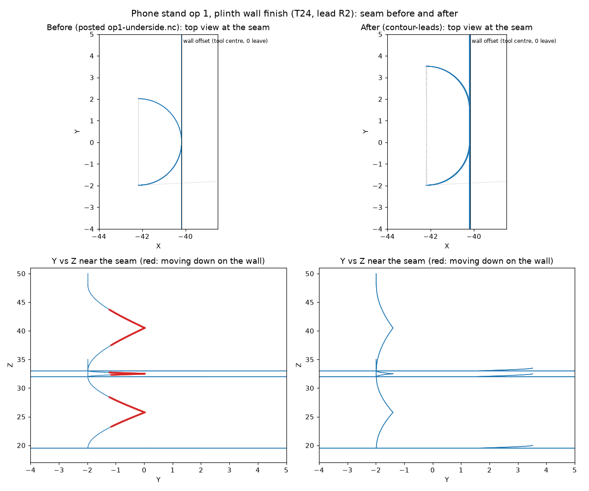

# Contour seams: leads, overlap and the light last lap

A closed contour pass starts and ends somewhere on the wall, and that spot often shows a witness mark. The
mark has a few causes:

- The tool bends away under the side load all the way round the wall. Coming on and going off it is only
  partly loaded, so it cuts a little deeper or shallower there.
- The loop ends exactly where it began, so any mismatch stays as a step.
- A Z move while the tool touches the wall (a ramp along the wall, or down the end of a lead-in arc) rubs a line.

With `lead` > 0 (new contours get half the tool's diameter), `lead_loop` in `cam_paths.rs` does the following:

| What | How | Field (default) |
|---|---|---|
| Seam position | the middle of the loop's longest straight side, away from corners and arcs, or the side nearest a chosen point | `seam` (none) |
| Coming down | ramps back and forth on the far half of the lead-in arc only, at least 0.29 × the radius off the wall; never a Z move on the wall | — |
| Overlap | the pass runs on past its start before leading off, so the end blends over the start | `overlap` (1.5 mm) |
| Lift-off | the lead-out arc rises up to a quarter of its radius (at most 1 mm) as the tool unloads | — |
| Arc too big | smaller arcs are tried (× 0.7 each time, down to a quarter of the tool's radius) before falling back to ramping along the wall | `lead` |
| Light last lap | when cutting to size (`leave` 0), the lap before stays this far out, so the last lap takes almost nothing and the tool hardly bends | `finish_lap` (0.03 mm; 0 = off) |
| Spring pass | the last lap once more at the same size | `spring_pass` (off) |

Roughing contours (`leave` > 0) keep a single lap. Documents saved with `lead: 0` keep ramping.

The picture shows phone stand op 1's plinth wall pass, as posted (left) and re-posted from this branch (right).
Before, the ramp went down the whole lead-in arc onto the wall (red). Now the ramp turns 0.6 mm off the wall,
the pass runs 1.5 mm past the start, and the lead-out rises 0.5 mm. Each level also has a 0.03 mm lap before
the last. The stock simulation reports no problems, and the wall pass peaks at 28% of the spindle.

Tests: `contour_leads_on_and_off_with_arcs` (inside), `contour_seam_overlaps_and_lifts_off` (outside: seam,
overlap, lift, seam point, spring pass, roughing), `contour_too_tight_for_a_lead_ramps`.
