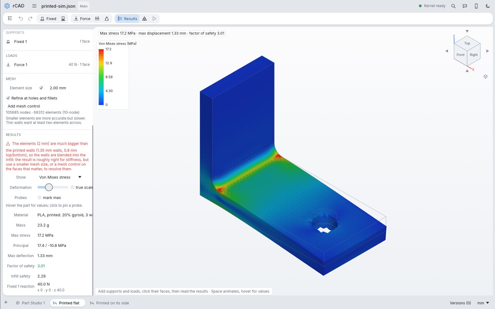

# 3D-printed plastics in the Simulation tab

Turn on **3D printed** under the material when the parts are a printable plastic. A printed part is
then a solid shell (its walls and its top and bottom layers) around a sparse infill, and it is weaker
between layers than along them.

## Settings

| Setting | Default | Meaning |
| --- | --- | --- |
| Print model | Layered | Layered: transversely isotropic about the build direction. Isotropic: one averaged modulus and the weakest (Z) strength everywhere. |
| Infill | 20 %, grid | Sparse density and pattern: grid / rectilinear, triangles, honeycomb, gyroid / cubic. |
| Walls | 2 × 0.45 mm | Wall loops × line width: the side shell. |
| Top / bottom | 4 × 0.2 mm | Solid layers × layer height: the shell on faces within 45° of facing up or down. |
| Build direction | +Z | The printer's Z in the Part Studio's axes. |

The agent and scripts set the same with `print: {model, infill, pattern, walls, line_width, top_bottom,
layer_height, build_dir}` on `create_simulation` / `edit_simulation` (`true` for the defaults, `null` for
solid).

## How it is modelled

- **Shell and infill.** Every node's distance to the part's surface is divided by the shell thickness
  there (top/bottom skin where the nearest surface faces up or down, walls elsewhere). Each element's
  shell share is the fraction of 35 sample points inside it that lie in the shell, and its material is
  that blend of shell and infill (in 1/8 steps). Mesh at about the wall thickness on faces where the
  stress matters, or the walls are blended into the infill (a warning says so).
- **Solid printed material** (the shell): makers' data for 100 % infill specimens printed flat (X-Y) and
  upright (Z), ISO 527.

  | Material | E X-Y / Z (MPa) | Strength X-Y / Z (MPa) | Source |
  | --- | --- | --- | --- |
  | PLA | 3427 / 3065 | 52.3 / 40.5 | Polymaker PolyLite PLA |
  | PETG | 2117 / 1899 | 50.8 / 42.8 | Polymaker PolyLite PETG |
  | ABS | 2247 / 2081 | 33.4 / 29.7 | Polymaker PolyLite ABS |
  | ASA | 2379 / 1965 | 43.8 / 32.0 | Polymaker ASA |
  | PC | 2497 / 2371 | 69.1 / 52.8 | Polymaker PolyLite PC |
  | Nylon (dry) | 2703 / 2209 | 78.0 / 45.8 | Polymaker PolyMide CoPA, dry |
  | Nylon (humid) | 724 / 660 | 34.3 / 13.7 | Polymaker PolyMide CoPA, wet (6 % water) |
  | PLA-CF | 3281 / 2213 | 31.2 / 15.1 | Polymaker PolyLite PLA-CF |
  | PETG-CF | 2460 / 1340 | 35 / 29 | Bambu Lab PETG-CF |
  | ASA-CF | 4200 / 2290 | 34 / 30 | Bambu Lab ASA-CF |
  | PET-CF | 4730 / 2160 | 74 / 35 | Bambu Lab PET-CF |

- **Infill** scales the solid's properties with its density ρ (Gibson–Ashby): exponent 1 where the
  infill's walls stretch, 2–3 where they bend.

  | Pattern | Layer plane stiffness | Z stiffness | Strength (plane / Z) |
  | --- | --- | --- | --- |
  | Grid / rectilinear | ρ/4 | ρ | ρ/4 / ρ |
  | Triangles | ρ/3 | ρ | ρ/3 / ρ |
  | Honeycomb | 1.5 ρ³ | ρ | 0.5 ρ² / ρ |
  | Gyroid / cubic | 0.8 ρ² | 0.8 ρ² | 0.3 ρ^1.5 |

  Each law is lifted by (1 − law(1)) ρ³ so that 100 % infill is the solid. Infill density also scales
  the mass.
- **Layered stiffness:** in-plane E_xy and ν, through-layer E_z, ν_zp = ν √(E_z/E_xy), interlayer shear
  modulus E_z / 2(1 + ν).
- **Failure (factor of safety):** the larger of von Mises over the in-plane strength and
  √((⟨σn⟩/Z)² + (τ/S)²) on the layer planes, with σn the tension across the layers (compression does not
  count), τ the shear along them, Z the Z strength and S = Z/√3. Nodes in the shell use the shell's
  strengths, nodes inside the infill's. The isotropic model uses von Mises against the Z strength.

`examples/fea-printed.json` solves the same PLA bracket printed flat and printed on its side: on its
side the bending runs along the layers, so it is about 20 % stiffer and its walls' factor of safety rises
from 3.0 to 3.6.

## Limits

- Linear elastic: no yielding, creep or fracture. The data-sheet values are best-case prints; upright
  prints can be up to 50 % weaker than flat ones, and humid nylon loses most of its stiffness.
- The layer plane is isotropic (±45° alternating rasters); single-direction rasters are stiffer along
  the road than across it.
- Advanced mode treats printed parts as solid and isotropic.

## References

- Polymaker technical data sheets: PolyLite PLA, PETG, ABS, PC, PLA-CF; Polymaker ASA; PolyMide CoPA.
  https://wiki.polymaker.com/polymaker-products/more-about-our-products/documents/technical-data-sheets
- Bambu Lab technical data sheets: PETG-CF (V3), ASA-CF (V1), PET-CF (V3).
- S.-H. Ahn, M. Montero, D. Odell, S. Roundy, P. K. Wright (2002), Anisotropic material properties of
  fused deposition modeling ABS, Rapid Prototyping Journal 8(4) 248–257, doi:10.1108/13552540210441166.
- C. Casavola, A. Cazzato, V. Moramarco, C. Pappalettere (2016), Orthotropic mechanical properties of
  fused deposition modelling parts described by classical laminate theory, Materials & Design 90
  453–458, doi:10.1016/j.matdes.2015.11.009.
- T. J. Gordelier, P. R. Thies, L. Turner, L. Johanning (2019), Optimising the FDM additive manufacturing
  process to achieve maximum tensile strength: a state-of-the-art review, Rapid Prototyping Journal.
- S. N. Cerda-Avila, H. I. Medellín-Castillo, T. Lim (2021), Analytical models to estimate the structural
  behaviour of fused deposition modelling components, Rapid Prototyping Journal 27(4) 658–670,
  doi:10.1108/RPJ-07-2020-0145.
- H. Rostro-González et al. (2024), Additive manufacturing gyroid structures used as crash energy
  management, Computation 12(12) 248, doi:10.3390/computation12120248.
- D. Hodzic, A. Pandzic (2021), Influence of infill design on compressive and flexural mechanical
  properties of FDM printed PLA material, Proc. 32nd DAAAM Int. Symposium 191–199,
  doi:10.2507/32nd.daaam.proceedings.029.
- J. J. Fekiač et al. (2025), Influence of infill geometry and density on the mechanical properties of
  3D-printed polylactic acid structure, J. Manuf. Mater. Process. 9(4) 134, doi:10.3390/jmmp9040134.
- L. J. Gibson, M. F. Ashby (1997), Cellular Solids: Structure and Properties, 2nd ed., Cambridge
  University Press.
