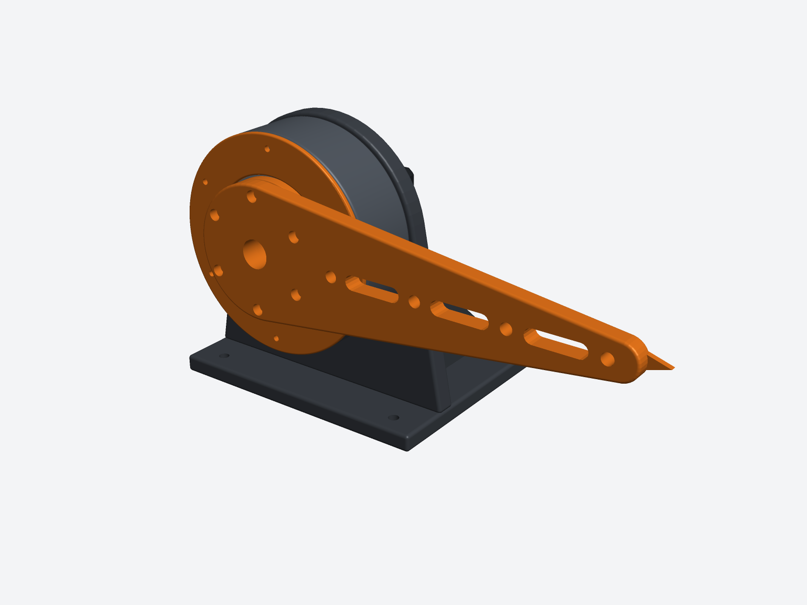
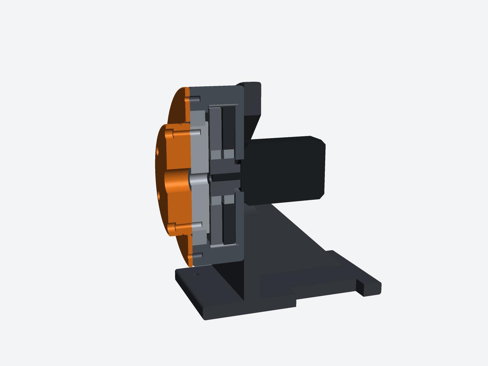
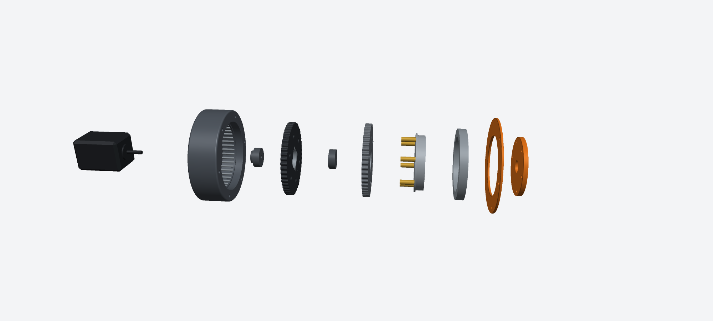
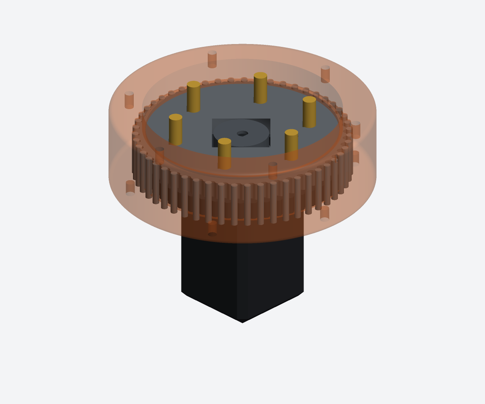
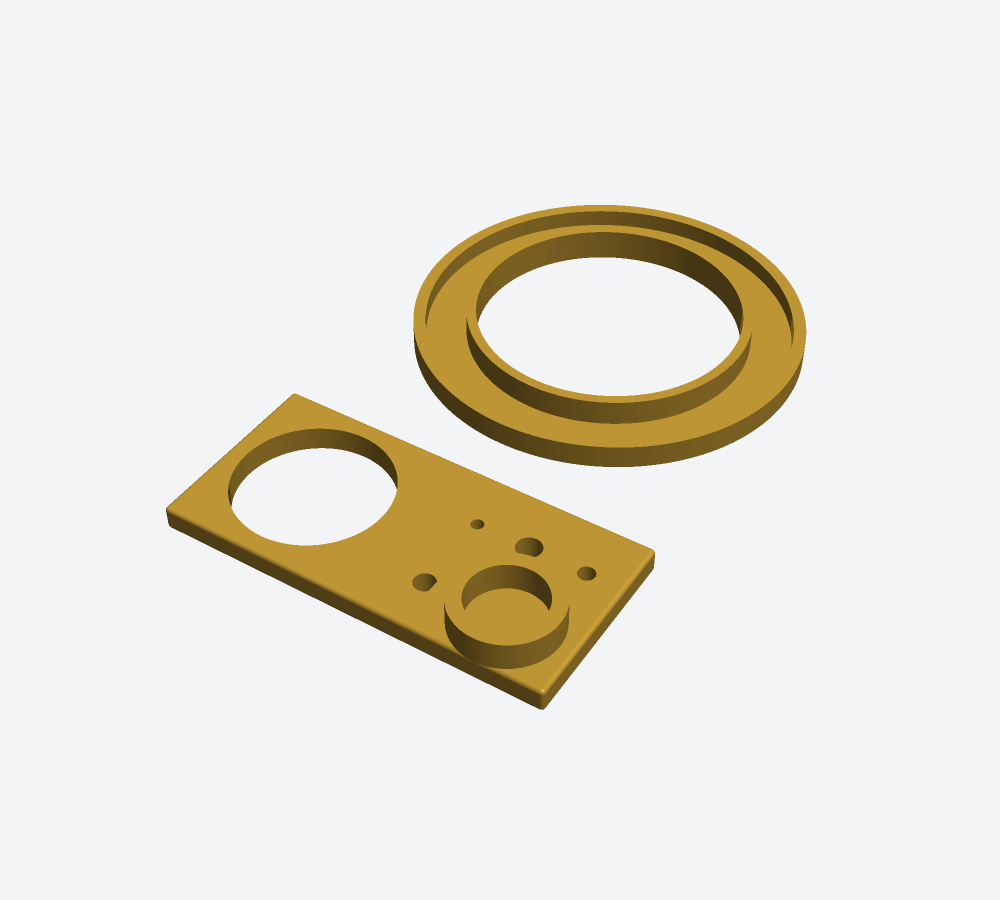

# Cycloidal gearbox prototype (L50, 50:1)

A bench test unit for the robot arm's shoulder gearbox, so it can be built and proven before the
rest of [the arm](../robot-arm-6dof/). It is the L50 gearbox from J2 (Ø120, two cycloid discs, 51 steel
ring pins, 50:1) with its NEMA 17 bolted straight on, an L-shaped stand that clamps to the bench, an
output flange and a 250 mm test lever with weight holes. It also has a tolerance coupon to print
first.

    mkdir out && rcad script examples/cycloidal-gearbox-prototype/parts.rhai out          # ~3 min
    mkdir out && rcad script examples/cycloidal-gearbox-prototype/parts.rhai out quick    # renders and summary only

To get an rCAD project file (one Part Studio per part plus a "Test unit" assembly), run the tool
script in that output folder afterwards:

    cd out && rcad run ../examples/cycloidal-gearbox-prototype/project.json    # writes cycloidal-gearbox-prototype.rcad.json

The parts script writes `print-*.stl` and `printed-*.step` for every printed part, `bought-*.step` for the bought ones, the assembly as
`cycloidal-gearbox-prototype.step`, five renders and `summary.json` (BOM, masses, z stack, and the
meshing and interference checks).

## What changed from the arm's gearbox

Checking the arm's L50 for a real build turned up six things that would stop it going together or
running. They are fixed here, and the arm's `actuator()` should get the same fixes:

1. **The cam was one piece and couldn't be assembled.** Both eccentric lobes are Ø25, so the first
   disc's bearing can't slide past the second lobe. It is now cam A (collar and lobe +E) and cam B
   (lobe −E). Both have a D-bore, so the flat on the motor shaft sets them 180° apart.
2. **The cam bore was round,** with nothing to drive it. It is now a D-bore (Ø5.1, flat at 2.05).
3. **The output bearing had no shoulder.** Its outer race sat over the Ø96 ring-pin bore, so a push
   on the output would slide it into the gearbox. A 2 mm ledge (Ø87 inside) now sits under it and
   also caps the ring pins.
4. **The carrier was held one way only.** It now has a lip under the bearing's inner race, and the
   output flange is a separate part bolted on top, so the inner race is clamped between them.
5. **The disc outline cut into the ring pins.** Sampling the cycloid evenly in its parameter leaves
   chords up to 1.5 mm long in the troughs round each pin. Those chords bulge 0.19 mm into the pins,
   which beats the 0.08 mm clearance by 0.11 mm. The outline is now sampled every 0.25 mm along the
   curve, which leaves about 0.005 mm. The lobe tips also reach 48.02 mm between the pins, past the
   Ø96 bore, so the bore is now Ø96.6. The pins still sit 157° deep in their grooves.
6. **The motor screws' heads hit disc A,** which runs 0.5 mm above the floor. The screws are now
   counterbored.

The dowels are also standard lengths now (ring pins 3×20, output pins 6×30).

`summary.json` → `mesh_checks` turns the cam through 8 input angles (0 to 263°). It moves the discs
(orbit E, turning −θ/50) and the output (−θ/50) and checks every pair: disc/ring pins, disc/output pins,
disc/housing, disc/carrier, cam/bearings. All overlaps are 0 mm³. The 26 static pairs (housing,
bearing, motor, stand, cover, flange, lever and so on) are also 0.

The arm's J2 drives this gearbox through a 2:1 belt and an Ø8 shaft. The prototype drives it straight
from the motor shaft. That tests the same cycloid stage, and it gives 50:1 instead of 100:1 at the
output.

## Parts list

### Printed (about 1.2 kg of PA-CF in total)

| Part | Qty | Material | Mass | Print orientation | Notes |
|---|---|---|---|---|---|
| Tolerance coupon | 1 | PA-CF | 25 g | flat | **print first**, see below |
| Tolerance coupon 6814 | 1 | PA-CF | 16 g | flat | **print first** |
| Housing | 1 | PA-CF | 233 g | rear face (motor side) down | 6 walls, 40 % gyroid |
| Cycloid disc A (one dimple) | 1 | PA-CF | 52 g | flat | 100 % infill, 0.15 mm layers |
| Cycloid disc B (two dimples) | 1 | PA-CF | 52 g | flat | 100 % infill, 0.15 mm layers |
| Cam A | 1 | PA-CF | 6 g | collar down | 100 % infill |
| Cam B | 1 | PA-CF | 5 g | flat | 100 % infill |
| Carrier | 1 | PA-CF | 53 g | lip down | 100 % infill |
| Output flange | 1 | PA-CF | 29 g | flat | 6 walls |
| Cover | 1 | ASA or PA-CF | 24 g | flat | |
| Test stand | 1 | PA-CF | 548 g | foot down | 4 walls, 25 % infill. The motor hole has a 45° peak, so it needs no support |
| Test lever | 1 | PA-CF | 129 g | flat, pointer down | 5 walls, 40 % infill |

The STLs come out in the orientation to print them in. Let the slicer drop each part onto the bed.
Use no supports anywhere. Dry PA-CF before printing.

### Bought

| Item | Qty | Spec | Used for |
|---|---|---|---|
| Stepper motor | 1 | NEMA 17, 60 mm (17HS24 class), ~0.65 N·m holding, Ø5 shaft ≥ 20 mm long **with a D-flat** | input |
| Thin-section bearing | 1 | 6814-2RS, 70×90×10 | output |
| Deep-groove bearing | 2 | 6805-2RS, 25×37×7 | discs on the cams |
| Dowel pin, hardened | 51 | ISO 8734 Ø3 m6 × 20 | ring pins (buy a 60 pack, a few get lost) |
| Dowel pin, hardened | 6 | ISO 8734 Ø6 m6 × 30 | output pins |
| Heat-set insert | 18 | M3, 5.7 mm long, for a Ø4.0 hole (e.g. Ruthex M3×5.7) | 6 housing rear, 6 housing top, 6 carrier top |
| Socket head screw | 4 | M3×6 DIN 912 | motor to housing (from inside) |
| Socket head screw | 6 | M3×8 | cover |
| Socket head screw | 12 | M3×12 | stand to housing (6). Flange to carrier when the lever is off (6) |
| Socket head screw | 6 | M3×16 | lever + flange to carrier |
| Wood screws or C-clamps | 4 / 2 | M5 wood screws, or two small C-clamps | stand to the bench |
| Grease | — | lithium or PTFE grease | ring pins, output pins, disc faces |
| Retaining compound (optional) | — | Loctite 638 or thin CA | cam D-bores on the motor shaft |

### For testing

| Item | Notes |
|---|---|
| Stepper driver | TMC2209 (the arm uses these) on 24 V, current set to 1.4–1.7 A RMS for a 2 A motor |
| Controller | anything that makes step/dir: the arm's ESP32-S3, an Arduino, or a 3D printer board |
| Weights | 1–6 kg in 1 kg steps (water bottles in a bag work), an S-hook or a loop of cord |
| Dial indicator or calipers | for backlash at the lever tip |
| Luggage scale (optional) | for a direct torque reading at the lever |

## Tune the fits first (tolerance coupon and the FIT table)

The gearbox depends on eight fits, and every printer prints holes and bosses a little differently.
Every printed hole or boss that mates with a bought part is drawn at its nominal size plus an offset
from the `FIT` table at the top of `parts.rhai`. The offsets are on the diameter, and + makes the
feature bigger. The coupon uses the same table, so it always shows what the real parts will be.

1. Print the two coupons in the material and settings you'll use for the real parts (about 30 min).
   Keep the slicer's hole/contour compensation at 0.
2. Check each fit and change its entry:

   | Coupon feature | `FIT` key | Fit wanted |
   |---|---|---|
   | Ø37 bore | `seat_6805` | 6805 presses in with a vise or a firm thumb press, no wobble |
   | Ø25 boss | `boss_6805` | 6805 slides on with a light push |
   | Ø5 D-bore | `shaft_d` | motor shaft goes in snug with no rotational play |
   | Ø3 hole | `ring_pin` | 3 mm dowel slides in freely, no rattle |
   | Ø6 hole | `out_pin_press` | 6 mm dowel presses in with a vise |
   | Ø4 holes | `insert_m3` | M3 insert goes in with the iron at 230–250 °C and holds |
   | Ø90 ring | `seat_6814` | 6814 presses in |
   | Ø70 boss | `boss_6814` | 6814 presses on |

   For example, if the 6805 falls out of the Ø37 bore, try `seat_6805: -0.1`. If it won't go in,
   try `0.15`. Typical FDM starting points: holes print 0.1–0.3 mm small and bosses 0.05–0.15 mm big.
   `clear_m3` and `motor_pilot` cover the screw and motor-boss clearances. `disc_gap` adds to the
   0.08 mm running gap between the discs and the pins, so raise it if the gearbox binds.
3. Re-run the script, reprint the coupon, and repeat until all eight are right. Then print the
   gearbox. `summary.json` records the offsets each set of files was made with (`fit_offsets`).

## Assembly

With the housing on its back (output side up):

1. **Inserts.** Melt in the 18 M3 inserts: 6 in the housing rear face, 6 in the housing top face and
   6 in the carrier top face. Set each one flush.
2. **Motor.** Hold the motor against the housing's rear face, with its pilot in the Ø22.5 hole and the
   connector pointing where you want the cable. Screw it on from inside the housing with 4× M3×6. The
   heads sit in the counterbores. Then stand the unit on the motor's back, in a cup or a roll of tape
   so it doesn't tip.
3. **Ring pins.** Smear grease in the 51 grooves and press a 3×20 dowel into each one. The grease holds
   them until the discs go in.
4. **Discs.** Press a 6805 into the centre of each disc, sitting 0.5 mm below each face.
5. **Cam A.** Push cam A onto the motor shaft, collar first, flat to flat, until the collar is about
   0.5 mm above the motor boss. Add a drop of retaining compound if you want it permanent.
6. **Disc A** (one dimple, dimple up). Lower it onto cam A's lobe. Turn the disc until its lobes drop
   between the ring pins.
7. **Cam B.** Push it onto the shaft, flat to flat, until it sits on cam A. Its lobe is now opposite
   cam A's.
8. **Disc B** (two dimples, dimples up). Lower it onto cam B the same way.
9. **Carrier.** Press the 6 output pins (6×30) into the carrier from the lip side until they're flush
   with the top face. Press the 6814 onto the carrier from the top until its inner race sits on the
   lip.
10. **Into the housing.** Lower the carrier (pins down) through the disc holes. You may need to rock the
    output a little to line the holes up. Press the 6814 into its seat until it sits on the ledge.
11. **Cover.** Screw it on with 6× M3×8.
12. **Flange.** Put it on the carrier, with its notch lined up with the housing's notch at 0°. Use
    6× M3×12 for now.
13. **Check by hand.** Leave the motor unplugged, because shorted windings brake it. Turn the
    flange. A full turn of the output is 50 turns of the motor. It should feel even all the way
    round. If one spot is tight, a disc is probably on the wrong lobe, or a pin has come out of its
    groove.
14. **Stand.** Bolt the housing's rear face to the stand with 6× M3×12 from behind.
15. **Lever.** Swap the flange screws for 6× M3×16 through the lever and flange.
16. **Bench.** Clamp or screw the foot to the bench. Keep the axis parallel to the edge and close
    to it, so the lever swings out over the edge and weights can hang off its holes.

## Tests

Steps per output turn = 200 × microsteps × 50 (160,000 at 16 microsteps). The output turns the
opposite way to the motor.

1. **Run-in, no lever.** 10 minutes each way at 300–600 motor rpm (6–12 output rpm). Listen for
   clicking (a pin riding up or a disc rubbing a face). Then check the housing temperature.
2. **Ratio.** Command exactly 1 output turn (160,000 microsteps). The flange notch should come back
   to the housing notch.
3. **Lost motion (backlash).** With the lever on and the motor energized but not moving, hang 0.5 kg
   in the 200 mm hole. Put a dial indicator (or calipers against a fixed block) on the pointer tip.
   Lift the weight off and push the tip the other way with about the same force. Lost motion in
   degrees = tip travel (mm) ÷ 200 × 57.3. My suggested target: under 0.3° (1 mm at the tip). That
   would be about 2.6 mm at the arm's 500 mm reach.
4. **Torque.** Start with the lever hanging, the weight in the 200 mm hole, and drive it up past
   horizontal at about 60 motor rpm. Torque at horizontal = mass × 9.81 × 0.2 N·m. The lever itself
   adds 0.08 N·m.

   | Weight at 200 mm | Torque | Meaning |
   |---|---|---|
   | 1 kg | 2.0 N·m | |
   | 2 kg | 4.0 N·m | |
   | 4 kg | 7.9 N·m | about what J2's gearbox sees in the arm (7.6 N·m, after the 2:1 belt) |
   | 6 kg | 11.9 N·m | 1.5× the arm's load |
   | stall | — | expected about 14.6 N·m (60 % of 0.65 N·m × 50 × 75 % efficiency) |

   If the motor skips at the arm's load, the gearbox loses more than expected. Check whether it is
   friction: the gearbox should turn smoothly by hand with the motor unplugged.
5. **Endurance.** Swing the lever ±60° with 4 kg in the 200 mm hole for 30 minutes. Then check the
   housing and disc temperatures (under ~50 °C), any black dust at the ring pins, and the lost
   motion again.
6. **Open it up.** Look for wear flats on the discs at the pin contact and for oval output-pin holes.
   Those tell you whether the disc material and infill are good enough for the arm.

