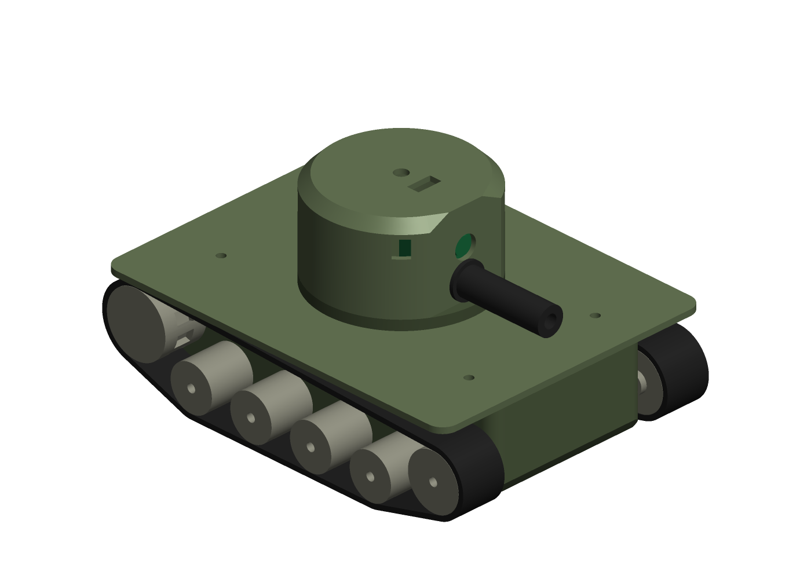
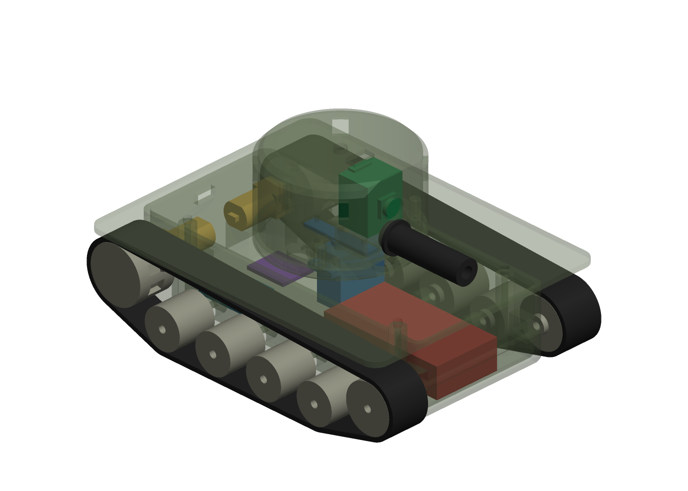
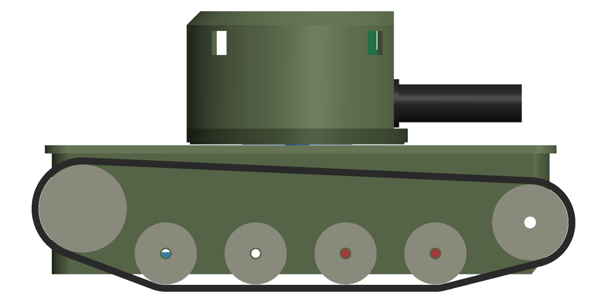

# FPV laser tag tank

`parts.rhai` builds a small tracked tank for FPV infrared laser tag: about 157 × 114 × 81 mm and
300 g ready to drive. A phone shows the camera feed over WiFi and sends the driving commands; an Xbox
style controller pairs with the phone.

    mkdir out && rcad script examples/fpv-tank/parts.rhai out

It writes one STEP and one STL per printed part, each lying in its print orientation and centred on
the bed, `fpv-tank-assembly.step`, renders, and `parts.json`. That file lists each part's estimated
printed mass, its print size and whether it fits a 254 mm cube, and every pair of parts in the
assembly that overlap (there should be none). The `stl/` folder here has a build of the STLs.

 

## Printed parts

| part | qty | material | notes |
|---|---|---|---|
| hull-tub | 1 | PLA or ABS | open top up; motor pockets, wheel axle bosses, idler slots, battery strap slots |
| deck | 1 | PLA or ABS | prints upside down (flat top on the bed); fenders cover the tracks, SG90 hangs underneath |
| turret-ring | 1 | PLA | prints upside down; the servo horn screws into the cross recess, the arc slot lets the wires through for ±90° |
| turret-shell | 1 | PLA | prints roof down; camera window, barrel socket, 4 hit sensor windows, LED and USB-C holes in the roof |
| barrel | 1 | PLA | 5 mm IR LED at the back, pushed into the turret front |
| sprocket | 2 | PLA | D bore for the N20 shaft, 10 pockets for the track lugs |
| idler | 2 | PLA | on an M3 screw in the tension slot |
| road-wheel | 8 | PLA | on M3 × 30 screws threaded into the hull bosses |
| track | 2 | TPU 95A | a loop standing on the bed, 42 lugs at 8 mm pitch inside |

About 210 g of filament per tank.

## Bought parts (per tank)

| part | approx. cost |
|---|---|
| Seeed XIAO ESP32S3 Sense (camera, WiFi, 8 MB PSRAM) | $14 |
| 2 × N20 gear motor, 6 V, ~300 rpm, 3 mm D shaft | $6 |
| SG90 micro servo (turret) | $2 |
| DRV8833 dual motor driver board | $1.50 |
| MP1584 buck converter set to 5 V | $1 |
| 2S 7.4 V 450 mAh LiPo (about 58 × 31 × 14) | $7 |
| 940 nm 5 mm IR LED, 4 × TSOP38238, WS2812 LED, mini slide switch | $4 |
| M3 × 30 screws (10), M3 nuts (2), M1.6 × 4 (4), M2 × 6 (3) | $2 |
| filament | $4 |
| **total** | **about $42** |

At 300 rpm on the 13.7 mm sprocket the tank does about 0.4 m/s (limit the PWM to about 75 % on a
full 2S pack, which is 8.4 V on a 6 V motor).

## Wiring

2S pack → switch → DRV8833 VM and the buck; the buck's 5 V feeds the XIAO's 5 V pin, the servo and
the LED. Suggested XIAO pins (check against the Sense board's SD card pins if you use the card):
D0–D3 motor PWM (AIN1, AIN2, BIN1, BIN2), D4 servo, D5 IR LED through an NPN or logic FET with a
series resistor, D6 the four TSOP outputs wired together (open collector, active low), D7 WS2812,
D8 battery voltage through a 100k/33k divider.

## Still to check on real parts

- XIAO Sense camera and USB-C positions in the turret are from the datasheet outline; adjust the
  cradle rails and the roof USB slot once a board is in hand.
- TPU track length: printed at the exact belt length (336 mm inside), the idler slot gives ±3 mm.
- The barrel is a plain tube; a 10 mm lens at the muzzle would give a tighter, longer beam.
- Ground clearance is 5 mm: fine on hard floors and thin rugs.
