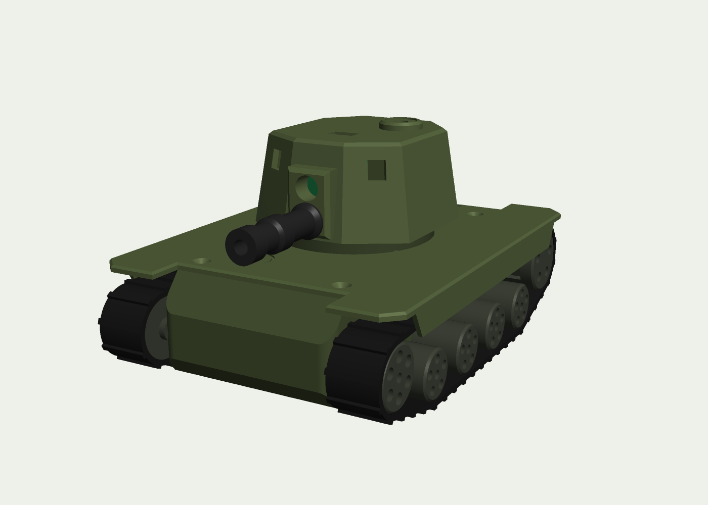
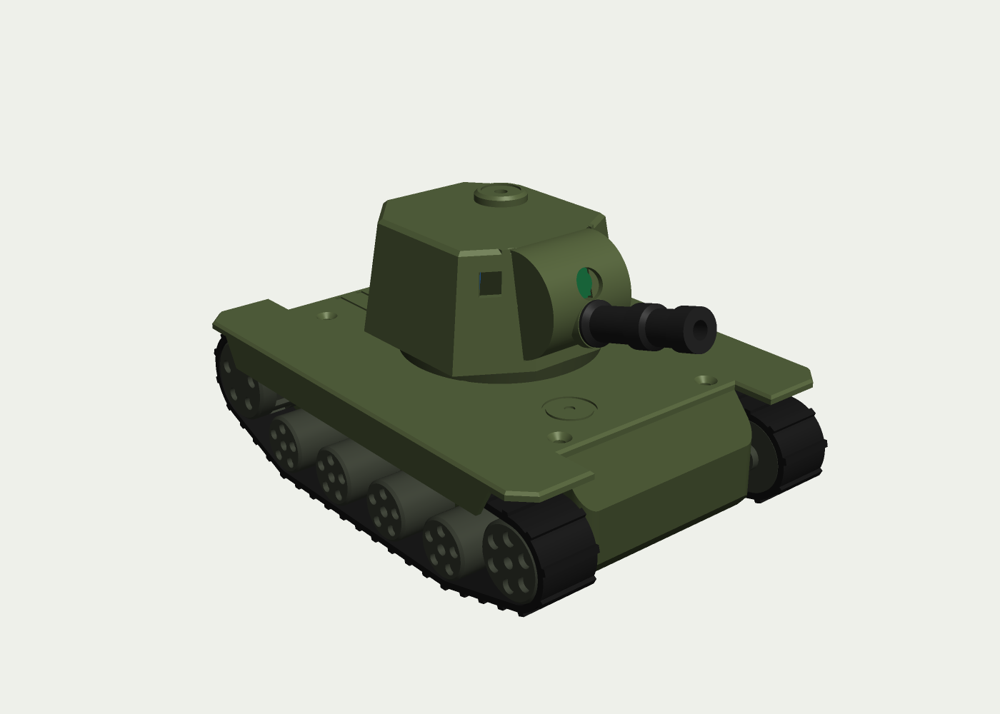
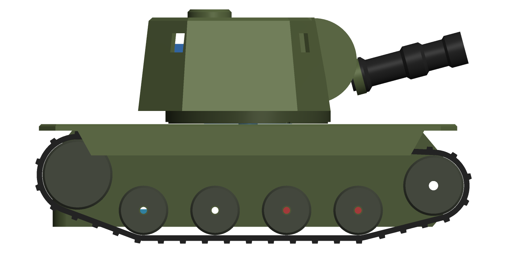
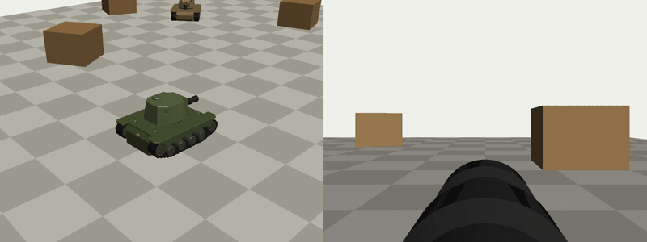

# FPV laser tag tank

`parts.rhai` builds a small tracked tank for FPV infrared laser tag: about 159 × 114 × 85 mm and
330 g ready to drive. The turret turns ±90° and the gun elevates from −6° to +20°; the camera
elevates with it, so the barrel stays at the same place in the video and works as the aim mark. A Radxa Zero 3W streams H.264 video from a Pi camera over WiFi to a phone,
which sends the driving commands back; an Xbox style controller pairs with the phone. An RP2040-Zero
does the real-time work (motors, servos, IR, LED, battery) and talks to the Radxa over UART.

    mkdir out && rcad script examples/fpv-tank/parts.rhai out

It writes one STEP and one STL per printed part, each lying in its print orientation and centred on
the bed, `fpv-tank-assembly.step`, renders, and `parts.json`. That file lists each part's estimated
printed mass, its print size and whether it fits a 254 mm cube, and every pair of parts in the
assembly that overlap, with the gun checked at full depression, level and full elevation (there
should be none). The `stl/` folder here has a build of the STLs.

 
 

## Animation

    mkdir -p out/frames && rcad script examples/fpv-tank/parts.rhai out animate
    ffmpeg -framerate 15 -i out/frames/f%04d.png -c:v libx264 -pix_fmt yuv420p fpv-tank-drive.mp4

`anim.rhai` drives the tank around an arena: the hull's speed and turn rate come from the two track
speeds (skid steering, 89 mm between the track centres), the wheels, sprockets and grousers turn to
match, then it traverses the turret, elevates the gun and fires the IR beam at a second tank, whose
hit LED lights up. Left: a chase camera. Right: what the tank's camera sees (OV5647, 53° × 41°), with
the barrel at the bottom as the aim mark. About 150 frames, 20 minutes to render.

## Printed parts

| part | qty | material | notes |
|---|---|---|---|
| hull-tub | 1 | PLA or ABS | open top up; upper and lower glacis, sloped rear plate; motor pockets, wheel axle bosses, idler slots, battery strap slots |
| deck | 1 | PLA or ABS | prints upside down (flat top on the bed); fenders and side skirts over the tracks, engraved grille and hatch, countersunk screws, SG90 hangs underneath |
| turret-ring | 1 | PLA | prints upside down; the servo horn screws into the cross recess, the arc slot lets the wires through for ±90° |
| turret-shell | 1 | PLA | prints roof down; faceted with a rear bustle, round embrasure for the gun drum with trunnion brackets either side, brackets for the elevation servo in the bustle, 4 hit sensor windows |
| gun-drum | 1 | PLA | prints on its side (the top side bridges 28 mm); the Pi camera screws to 4 standoffs behind the front window (mounted upside down, flip the image in software), barrel socket below it; turns on two M2 screws, open at the back for the camera ribbon |
| cupola | 1 | PLA | spigot into the turret roof; the hit LED shines through it |
| barrel | 1 | PLA | prints standing on its back end; 5 mm IR LED at the back, glued into the drum's socket |
| sprocket | 2 | PLA | D bore for the N20 shaft, 10 pockets for the track lugs; outer face on the bed |
| idler | 2 | PLA | on an M3 screw in the tension slot |
| road-wheel | 8 | PLA | on M3 × 30 screws threaded into the hull bosses |
| track | 2 | TPU 95A | a loop standing on the bed, 42 lugs at 8 mm pitch inside, grousers outside |

About 215 g of filament per tank.

## Bought parts (per tank)

| part | approx. cost |
|---|---|
| Radxa Zero 3W, 1 GB (quad A55, WiFi, H.264 encoder) + u.FL antenna | $22 |
| OV5647 camera (Pi Camera v1.3 or clone, 25 × 24) + 22-to-15 pin Zero ribbon, 20 cm | $10 |
| microSD card, 16 GB | $5 |
| RP2040-Zero (real-time IO) | $4 |
| 2 × N20 gear motor, 6 V, ~300 rpm, 3 mm D shaft | $6 |
| 2 × SG90 micro servo (turret, gun elevation) | $4 |
| DRV8833 dual motor driver board | $1.50 |
| MP1584 buck converter set to 5 V | $1 |
| 2S 7.4 V 450 mAh LiPo (about 58 × 31 × 14) | $7 |
| 940 nm 5 mm IR LED, 4 × TSOP38238, WS2812 LED, mini slide switch | $4 |
| M3 × 30 screws (10), M3 nuts (2), M1.6 × 4 (4), M2 × 6 (7), 1 mm steel wire for the pushrod | $2 |
| filament | $4 |
| **total** | **about $73** |

At 300 rpm on the 13.7 mm sprocket the tank does about 0.4 m/s (limit the PWM to about 75 % on a
full 2S pack, which is 8.4 V on a 6 V motor).

## Wiring

2S pack → switch → DRV8833 VM and the buck; the buck's 5 V feeds the Radxa (5 V pin on the header),
the RP2040-Zero, both servos and the LED. The camera ribbon goes from the back of the gun drum down
through the turret ring's arc slot and the slot in the deck to the Radxa, so it twists with the
turret and bends with the gun: leave a loop of slack in the turret.

The Radxa runs the video, WiFi and game logic and sends commands over UART (Radxa UART TX/RX ↔
RP2040 GP1/GP0). Suggested RP2040-Zero pins: GP2–GP5 motor PWM (AIN1, AIN2, BIN1, BIN2), GP6 turret
servo, GP7 gun elevation servo, GP8 IR LED through an NPN or logic FET with a series resistor (38 kHz
carrier from a PIO), GP9 the four TSOP outputs wired together (open collector, active low), GP10
WS2812 in the cupola, GP26 battery voltage through a 100k/33k divider. rCAD's PCB tab can simulate
the RP2040 firmware.

## Still to check on real parts

- Radxa's docs list the Pi Camera v1.3 (OV5647) and v2 (IMX219) as supported on the 4-lane 22-pin
  CSI connector (enable the overlay with `rsetup`); check the ribbon's orientation, since some
  boards shipped with the connector reversed. Hardware H.264 streaming from the camera goes through
  Rockchip's MPP encoder (for example GStreamer's `mpph264enc`); try it on one board before buying
  four.
- The Zero 3W has no on-board WiFi antenna: fit the u.FL antenna along the inside of the deck.
- The camera position in the drum is from the Pi Camera v1.3 drawing; check it with a camera in hand.
- Gun elevation: the elevation servo's horn and the drum's pushrod hole are both 13 mm from their
  axes, so the gun turns as far as the servo does; limit it to −6°…+20° in the firmware.
- TPU track length: printed at the exact belt length (336 mm inside), the idler slot gives ±3 mm.
- The barrel is a plain tube; a 10 mm lens at the muzzle would give a tighter, longer beam.
- Ground clearance is 5 mm: fine on hard floors and thin rugs.
- The barrel fills the bottom third of the camera's view (see the animation) with the standard
  OV5647 lens. A wide-angle OV5647 (120°–160°, same board size) makes it smaller and is easier to
  drive with.
