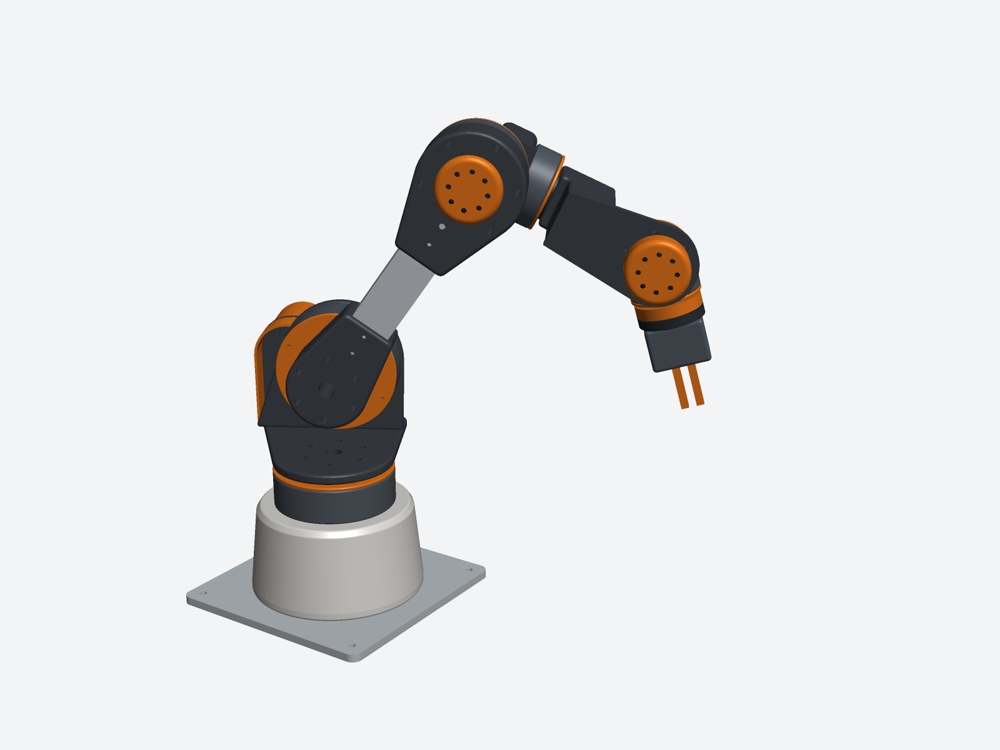
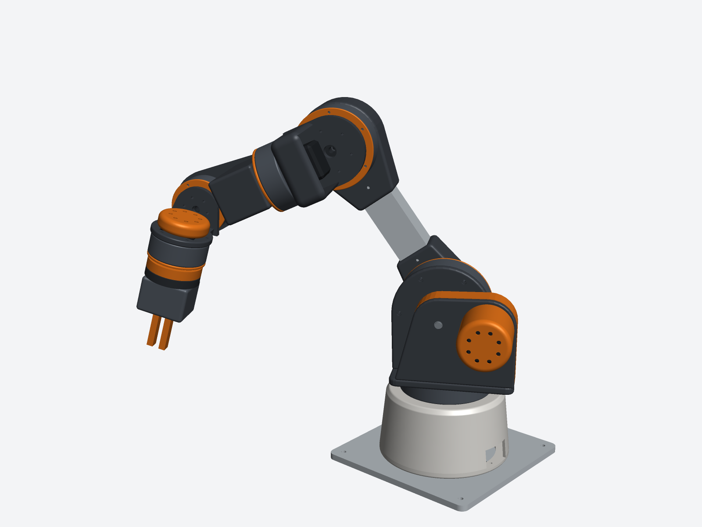
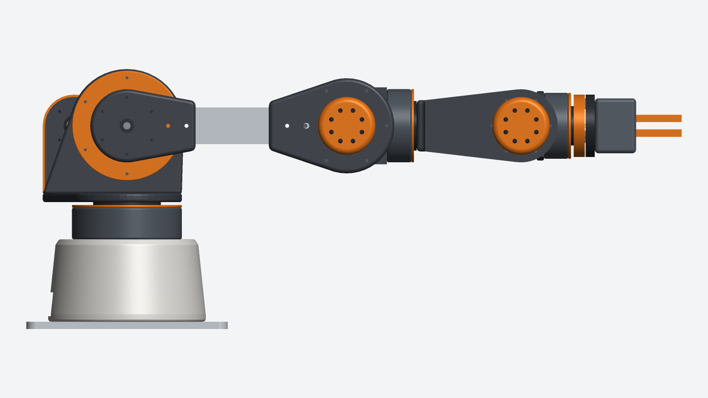
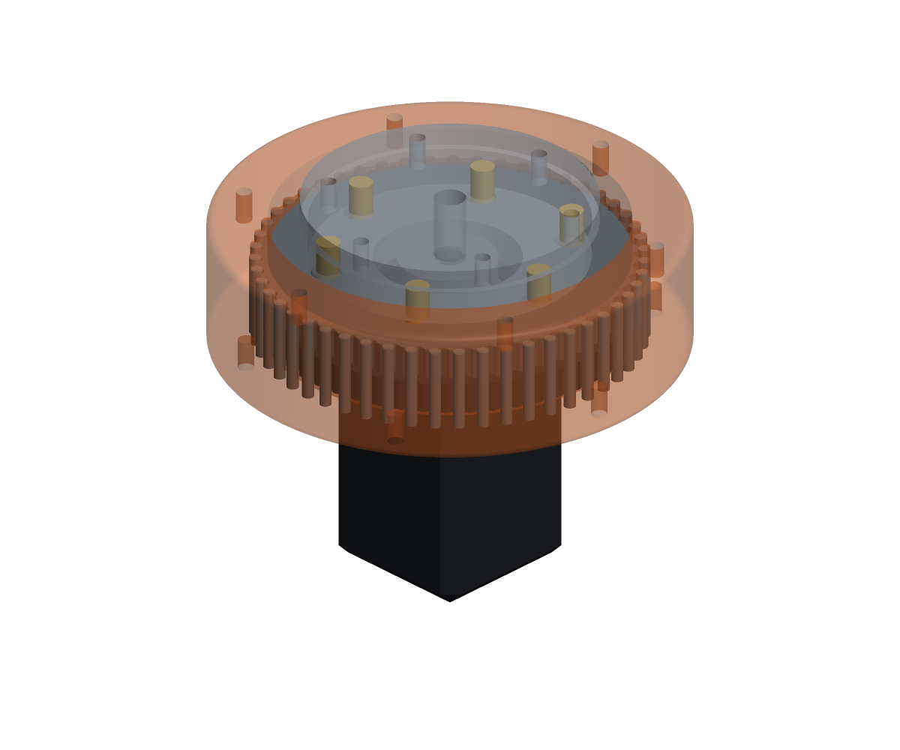
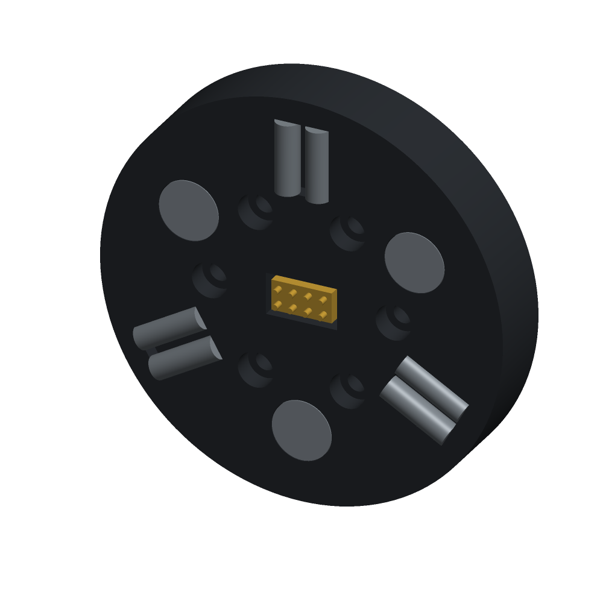

# 6-axis robot arm with printed cycloidal gearboxes

`parts.rhai` builds a 6-axis arm meant to be built at home: 500 mm reach from the shoulder axis to the
tool face, 1 kg payload including the tool, NEMA 17 steppers driving 3D-printed cycloidal gearboxes, and
a magnetic tool changer with pogo pins so tools can be powered and talk to the controller.

    mkdir out && rcad script examples/robot-arm-6dof/parts.rhai out          # everything (~2 min)
    mkdir out && rcad script examples/robot-arm-6dof/parts.rhai out quick    # renders and summary only

It writes a STEP and an STL for every printed part (`printed-*.step`, `print-*.stl`), a STEP for each
cut part (`cut-*.step`), the whole arm posed and stretched out as STEP, four renders and `summary.json`
(masses, the torque each joint needs against what its actuator gives, interference checks, the BOM).

## Layout

| | |
|---|---|
| Reach | 500 mm, J2 axis to tool face (upper arm 240, forearm 190.5, wrist centre to tool face 69.5) |
| J2 height | 222 mm above the table |
| Wrist | spherical: J4, J5 and J6 meet at one point, so inverse kinematics has a closed form |
| Arm mass | about 7.2 kg without the tool |
| Materials | PA-CF (carbon-filled nylon) for every structural print, which the heated chamber and hardened nozzle handle; ASA for the cosmetic parts (base drum, gearbox cover rings, motor caps, belt cover) |

The links are rounded, filleted shells rather than plates: teardrop hubs taper into the upper arm
tube, the elbow is a closed housing around the J4 motor, and the base is a tapered drum. Motors that
stick out of their brackets get vented caps, and a band closes the J2 belt bay. The renders show
the structure in graphite (PA-CF) with orange accents (ASA).

The upper arm is a 40×40×2 aluminium square tube cut to 180 mm with four Ø4.3 holes; everything else
structural is printed. The base plate is 8 mm aluminium with drilled holes only. Every printed part
fits a 300×250 bed.

## Joints

All six use the same gearbox design in four sizes: two cycloid discs 180° apart on a double eccentric
cam, steel dowel ring pins half sunk in the housing wall, steel output pins pressed into the carrier, and
a thin-section output bearing. The motor bolts to the back of the housing and the housing's back face
bolts to the link before it, with the motor passing through a square hole in that link.

| Joint | Gearbox | Ratio | Motor | Needs (N·m) | Gives (N·m) | Margin |
|---|---|---|---|---|---|---|
| J1 base | L30, Ø120 | 30 | 17HS19, 48 mm | (no gravity load) | 6.1 | |
| J2 shoulder | L50, Ø120, + 2:1 GT2 belt | 100 | 17HS24, 60 mm | 14.4 | 27.8 | 1.9× |
| J3 elbow | M30, Ø100 | 30 | 17HS24, 60 mm | 5.1 | 8.8 | 1.7× |
| J4 forearm roll | S20, Ø80 | 20 | 17HS16, 40 mm | 1.2 | 3.6 | 2.9× |
| J5 wrist pitch | XS20, Ø72 | 20 | 17HS13, 34 mm | 1.2 | 2.5 | 2.0× |
| J6 tool roll | XS20, Ø72 | 20 | 17HS4023 pancake | 0.3 | 1.2 | 4.0× |

"Needs" is the static torque with the arm stretched out flat holding 1 kg, which is the worst case.
"Gives" assumes 60 % of the motor's holding torque is usable at working speed on 24 V and 75 % gearbox
efficiency (95 % more for the belt). J2 gets a 20T to 40T GT2 belt in front of its gearbox because the
50:1 gearbox alone only matched the load. The J2 motor sits on an outrigger plate behind the shoulder
and drives an Ø8 input shaft through two 608 bearings.

Disc profiles are the exact cycloid offset 0.08 mm inward for clearance. The script checks that the
discs only touch the ring pins (a few mm³ of tangent contact) and that the second disc's holes line up
with the output pins.

## Tool changer

- **Location:** a kinematic coupling. Three pairs of Ø4 dowels form V-grooves at 120°, and three Ø8
  steel balls on the tool plate sit in them, so the tool lands in exactly the same place every time.
- **Holding:** three Ø10×3 N52 magnets on each side, about 60 N together. That holds 1 kg on a 45 mm lever
  with a safety factor of about 2. To drop a tool, park it in a rack that grabs its rim and tilt J5 to
  peel it off (about 1.8 N·m, within J5's 2.5).
- **Pogo pins:** an 8-pin, 2.54 mm spring-loaded connector in the middle meets gold pads on a small PCB in
  the tool plate. Pinout: 24 V, 24 V, GND, GND, CAN-H, CAN-L, TOOL_DETECT (the tool ties it to GND), spare.
  Each tool carries a small CAN board, so it can say what it is and take commands. Power is doubled up for
  about 3 A at 24 V.

The example tool (a block with two fingers) only stands in for a real tool. Its weight counts inside the 1 kg.

## Electronics (budget $200)

| Item | Approx. |
|---|---|
| ESP32-S3 DevKitC (has a CAN controller built in) | $10 |
| 6× TMC2209 StepStick drivers (quiet, UART current control) | $24 |
| 6× NEMA 17 (2× 60 mm, 48, 40, 34 mm, pancake) | $70 |
| 6× AS5600 magnetic encoders + TCA9548A I2C mux, for absolute joint position on each output (no homing switches) | $15 |
| 2× SN65HVD230 CAN transceivers (arm + first tool) | $5 |
| 24 V 6.5 A power supply | $20 |
| Pogo connector pair, pad PCB, 24→5 V buck, fuse, wire and connectors | $25 |
| Perfboard or a small carrier PCB | $8 |
| **Total** | **about $177** |

The controller board sits inside the base housing under the J1 motor.

## Mechanical parts (not counted in the $200)

Bearings: 2× 6814, 6812, 6810, 2× 6808, 4× 6805, 2× 6804, 6× 6803, 2× 608. Dowel pins for the ring pins and
output pins (sizes in `summary.json`), 6× Ø4×12 dowels and 3× Ø8 balls for the coupling, 6 magnets, a GT2
20T and 40T pulley with a 6 mm belt, 40×40×2 tube, 8 mm plate, M3/M4 screws and M3 heat-set inserts.

## Not done yet

- **J1 load path:** the turntable rides only on the J1 gearbox's 6814 bearing, which takes the whole
  arm's tipping moment (about 15 N·m). A second bearing or a lazy-susan ring under the turntable would
  take that load off the gearbox.
- **Encoders:** the AS5600 magnets and boards aren't modelled yet; they go on the carrier and the cover.
- **Cable routing:** no channels yet for the J5/J6 motor and encoder wires through the forearm, or for
  the tool cable through J6. J4 and J6 rotation will need limits (about ±170°) until then.
- **Joint limits** and a collision sweep over the full joint range.
- **Firmware.**
