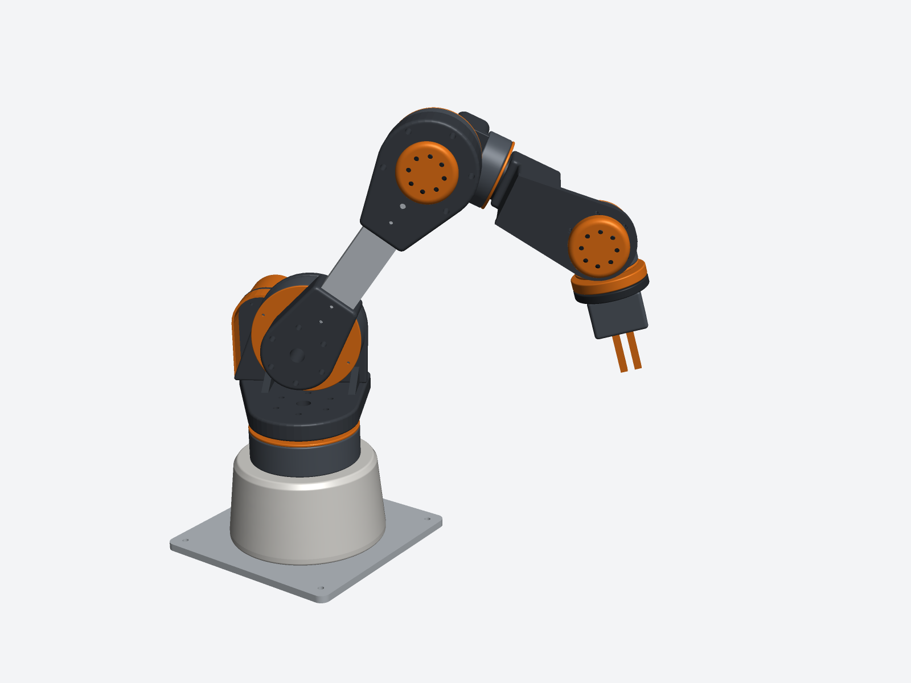
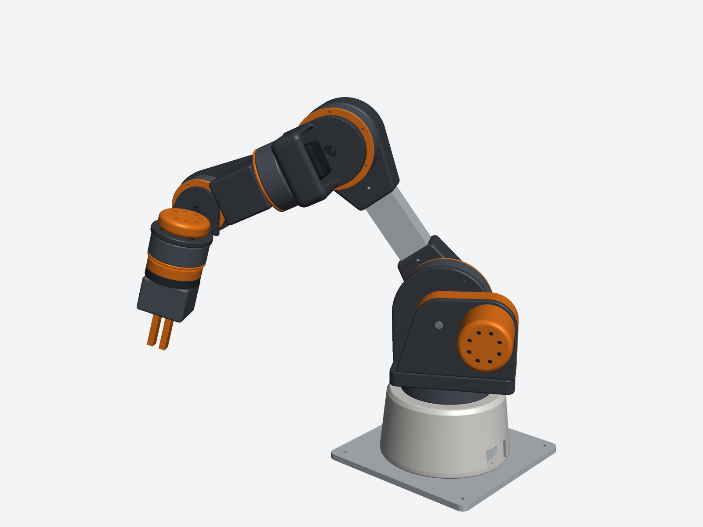
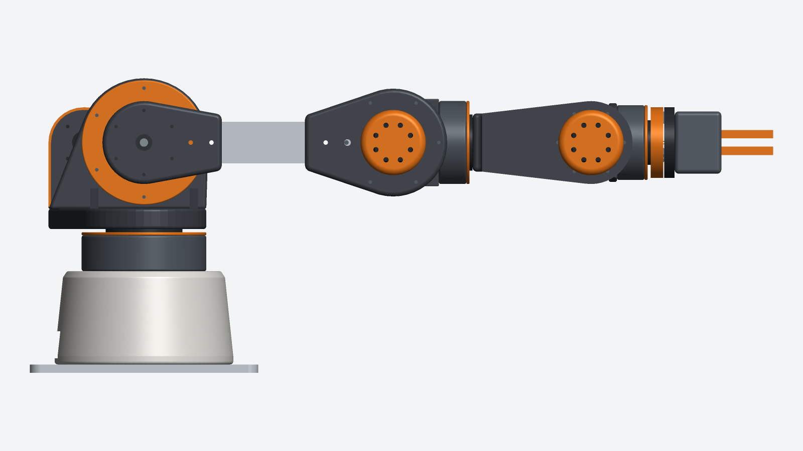
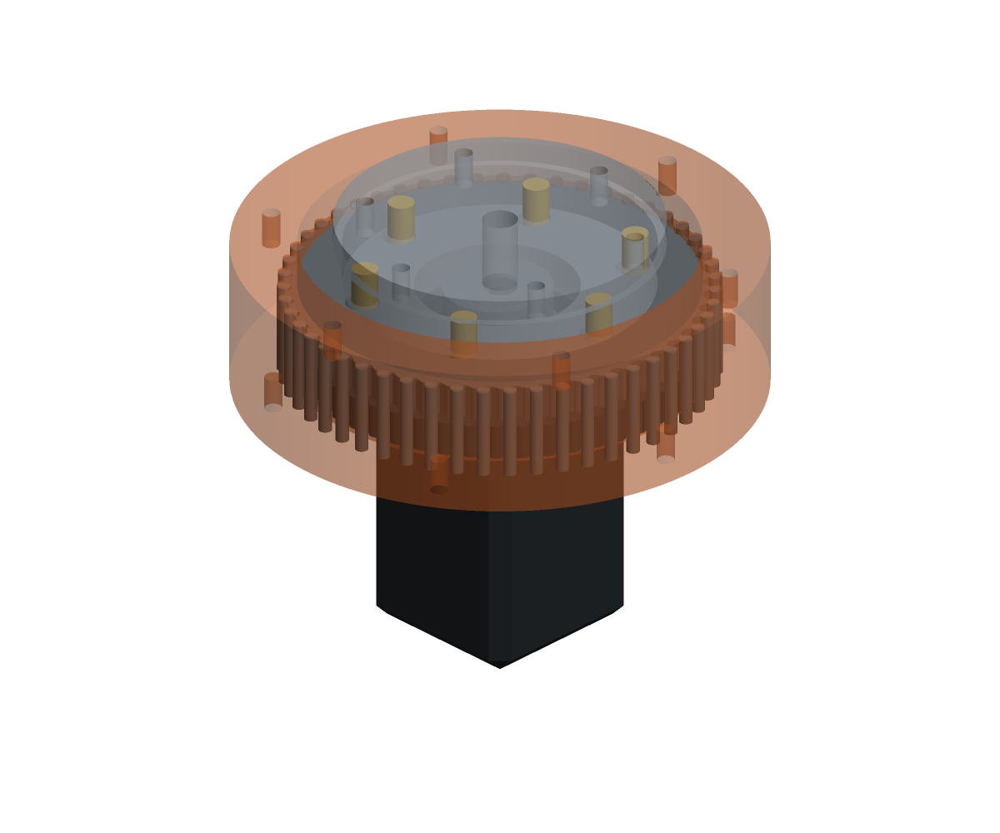
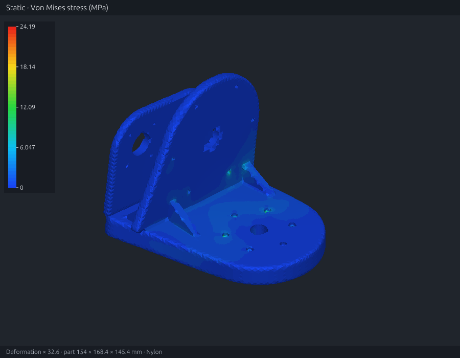
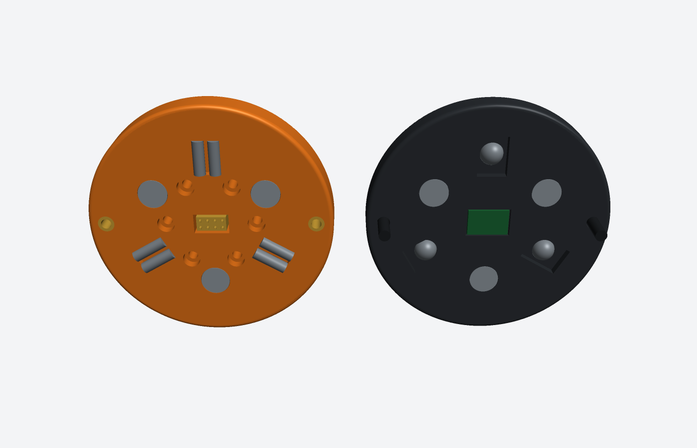

# 6-axis robot arm with printed cycloidal gearboxes

`parts.rhai` builds a 6-axis arm meant to be built at home: 500 mm reach from the shoulder axis to the
tool face, 1 kg payload including the tool, NEMA 17 steppers driving 3D-printed cycloidal gearboxes, and
a magnetic tool changer with pogo pins so tools can be powered and talk to the controller.

    mkdir out && rcad script examples/robot-arm-6dof/parts.rhai out          # everything (~2 min)
    mkdir out && rcad script examples/robot-arm-6dof/parts.rhai out quick    # renders and summary only

It writes a STEP and an STL for every printed part (`printed-*.step`, `print-*.stl`), a STEP for each
cut part (`cut-*.step`), the whole arm posed and stretched out as STEP, four renders and `summary.json`
(masses, the torque each joint needs against what its actuator gives, interference checks, the BOM).

## Layout

| | |
|---|---|
| Reach | 500 mm, J2 axis to tool face (upper arm 240, forearm 190.5, wrist centre to tool face 69.5) |
| J2 height | 222 mm above the table |
| Wrist | spherical: J4, J5 and J6 meet at one point, so inverse kinematics has a closed form |
| Arm mass | about 7.2 kg without the tool |
| Materials | PA-CF (carbon-filled nylon) for every structural print, which the heated chamber and hardened nozzle handle; ASA for the cosmetic parts (base drum, gearbox cover rings, motor caps, belt cover) |

The links are rounded, filleted shells rather than plates: teardrop hubs taper into the upper arm
tube, the elbow is a closed housing around the J4 motor, and the base is a tapered drum. Motors that
stick out of their brackets get vented caps, and a band closes the J2 belt bay. The renders show
the structure in graphite (PA-CF) with orange accents (ASA).

The upper arm is a 40×40×2 aluminium square tube cut to 180 mm with four Ø4.3 holes; everything else
structural is printed. The base plate is 8 mm aluminium with drilled holes only. Every printed part
fits a 300×250 bed.

## Joints

All six use the same gearbox design in four sizes: two cycloid discs 180° apart on a double eccentric
cam, steel dowel ring pins half sunk in the housing wall, steel output pins pressed into the carrier, and
a thin-section output bearing. The motor bolts to the back of the housing and the housing's back face
bolts to the link before it, with the motor passing through a square hole in that link.

| Joint | Gearbox | Ratio | Motor | Needs (N·m) | Gives (N·m) | Margin |
|---|---|---|---|---|---|---|
| J1 base | L30, Ø120 | 30 | 17HS19, 48 mm | (no gravity load) | 6.1 | |
| J2 shoulder | L50, Ø120, + 2:1 GT2 belt | 100 | 17HS24, 60 mm | 14.4 | 27.8 | 1.9× |
| J3 elbow | M30, Ø100 | 30 | 17HS24, 60 mm | 5.1 | 8.8 | 1.7× |
| J4 forearm roll | S20, Ø80 | 20 | 17HS16, 40 mm | 1.2 | 3.6 | 2.9× |
| J5 wrist pitch | XS20, Ø72 | 20 | 17HS13, 34 mm | 1.2 | 2.5 | 2.0× |
| J6 tool roll | XS20, Ø72 | 20 | 17HS4023 pancake | 0.3 | 1.2 | 4.0× |

"Needs" is the static torque with the arm stretched out flat holding 1 kg, which is the worst case.
"Gives" assumes 60 % of the motor's holding torque is usable at working speed on 24 V and 75 % gearbox
efficiency (95 % more for the belt). J2 gets a 20T to 40T GT2 belt in front of its gearbox because the
50:1 gearbox alone only matched the load. The J2 motor sits on an outrigger plate behind the shoulder
and drives an Ø8 input shaft through two 608 bearings.

Disc profiles are the exact cycloid offset 0.08 mm inward for clearance. The script checks that the
discs only touch the ring pins (a few mm³ of tangent contact) and that the second disc's holes line up
with the output pins.

## Strength of the printed brackets

`fea.json` runs a static FEA on the four L-shaped printed parts that carry the arm: the turntable/tower,
the elbow housing, the forearm and the wrist link. Run it in the output folder after `parts.rhai`:

    cd out && rcad run ../examples/robot-arm-6dof/fea.json

Each part is held by the bolt holes of the joint it sits on. The bolt holes at its other end are tied
rigidly to the centre of mass of everything it carries (from `fea_loads` in `summary.json`), loaded
with twice that weight to cover acceleration and knocks, with the arm stretched out flat. rCAD has no
PA-CF in its library, so the runs use Nylon (E 2.7 GPa). Stresses hardly depend on E. PA-CF is about
2.5 times stiffer, so real deflections are smaller than these.

| Part | Before: peak (MPa) | After: peak (MPa) | Where the peak is now |
|---|---|---|---|
| Turntable/tower | 160 principal, 2.8 mm sag at the tool | 24 von Mises, 0.4 mm | a J2 bolt hole |
| Elbow housing | 20 principal | 12 | a J4 bolt hole |
| Forearm | 13 principal | 9 | a J4 carrier bolt hole |
| Wrist link | 8.5 principal | 8.5 | a J6 bolt hole (unchanged) |

The turntable was the weak spot. The tower stood on a 10 mm plate about 30 mm away from the J1
flange, so the whole arm's moment bent that plate. The fixes:

- **Turntable/tower:** the plate is 20 mm thick (this limits J2 to about 30° below horizontal before
  the shoulder hub's tail reaches it). Two gussets sit in front of the tower beside the J2 housing,
  and a wedge runs along the tower root inside the belt bay.
- **Elbow housing:** the side plate on the J3 carrier is 14 mm instead of 10, and the inside corners
  are filleted at 6 mm.
- **Forearm:** the cheek carrying J5 is 14 mm instead of 10.

All the remaining peaks are at bolt holes, where the model holds the hole wall rigidly. That
overstates the stress compared with a clamped flange. Everywhere else the parts stay under about
5 MPa.

PA-CF is around 90 MPa strong along the layers but only about 30 MPa across them. So the
worst peak, 24 MPa at twice the load, is fine along the layers and about 1.25 across them. Print
orientation:

- **Turntable:** flat on its base, so the tower's layers stack upward and the bolt loads stay in
  the plane of the layers.
- **Elbow housing:** on the J4 end plate, so the side plate's bending runs along the layers.
- **Forearm and wrist link:** lying on their big flat plate.

Use 5–6 walls around the bolt holes and heat-set inserts, which spread the load into more plastic
than a thread cut in the plastic.

## Tool changer

- **Location:** a kinematic coupling. Three pairs of Ø4 dowels form V-grooves at 120°, and three Ø8
  steel balls on the tool plate sit in them, so the tool lands in exactly the same place every time.
  The balls sit 4.91 mm off the arm face, just touching the dowels; the script checks that they touch
  without overlapping.
- **Locking:** two M4×16 socket head screws in the tool plate, at 0° and 180° on Ø72, go into M4
  heat-set inserts in the arm side. They sit outside the tool body, so a 3 mm hex key reaches them
  from the tool side. **Tighten to 0.2 N·m, no more** (a torque screwdriver, or a gentle two-finger
  turn on a short hex key). That's about 250 N per screw (nut factor 0.2). The simulation check puts the
  lift-off safety factor at about 11 against the worst tool roll, where the magnets alone gave 1.15.
  The limit is the contact between each ball and its two dowels, not the screws. At 0.5 N·m each ball
  pushes about 240 N into a Ø4 dowel, about 4.7 GPa of Hertz pressure, which dents even hardened steel.
  At 0.2 N·m it's about 3.6 GPa, under the roughly 4.2 GPa that hardened steel takes.
- **Hardened balls and dowels:** use hardened steel for both, so grade G10–G25 chrome steel bearing balls
  (about 60 HRC) and hardened, ground dowel pins (h6 or m6, about 58–62 HRC). Mild-steel pins or
  unhardened balls will brinell at these contact stresses, and then the coupling loses its repeatability.
- **Magnets:** three Ø10×3 N52 magnets on each side still pull the tool onto the balls and hold it
  while you start the screws, so you don't need a third hand. They no longer carry the load.
- **Pogo pins:** an 8-pin, 2.54 mm spring-loaded connector in the middle meets gold pads on a small PCB in
  the tool plate. Pinout: 24 V, 24 V, GND, GND, CAN-H, CAN-L, TOOL_DETECT (the tool ties it to GND), spare.
  Each tool carries a small CAN board, so it can say what it is and take commands. Power is doubled up for
  about 3 A at 24 V.

Tool changes are now by hand, two screws each. A tool built for this plate has to leave room for
the hex key at the two screw positions (its body has to stay inside about ±30 mm of the axis in that
direction). The example tool (a block with two fingers) only stands in for a real tool. Its weight
counts inside the 1 kg.

## Electronics (budget $200)

| Item | Approx. |
|---|---|
| ESP32-S3 DevKitC (has a CAN controller built in) | $10 |
| 6× TMC2209 StepStick drivers (quiet, UART current control) | $24 |
| 6× NEMA 17 (2× 60 mm, 48, 40, 34 mm, pancake) | $70 |
| 6× AS5600 magnetic encoders + TCA9548A I2C mux, for absolute joint position on each output (no homing switches) | $15 |
| 2× SN65HVD230 CAN transceivers (arm + first tool) | $5 |
| 24 V 6.5 A power supply | $20 |
| Pogo connector pair, pad PCB, 24→5 V buck, fuse, wire and connectors | $25 |
| Perfboard or a small carrier PCB | $8 |
| **Total** | **about $177** |

The controller board sits inside the base housing under the J1 motor.

## Mechanical parts (not counted in the $200)

Bearings: 2× 6814, 6812, 6810, 2× 6808, 4× 6805, 2× 6804, 6× 6803, 2× 608. Dowel pins for the ring pins and
output pins (sizes in `summary.json`), 6× Ø4×12 hardened dowels and 3× Ø8 hardened bearing balls for the coupling, 6 magnets, 2 M4×16 screws and 2 M4 heat-set inserts for the tool lock, a GT2
20T and 40T pulley with a 6 mm belt, 40×40×2 tube, 8 mm plate, M3/M4 screws and M3 heat-set inserts.

## Not done yet

- **J1 load path:** the turntable rides only on the J1 gearbox's 6814 bearing, which takes the whole
  arm's tipping moment (about 15 N·m). A second bearing or a lazy-susan ring under the turntable would
  take that load off the gearbox.
- **Encoders:** the AS5600 magnets and boards aren't modelled yet; they go on the carrier and the cover.
- **Cable routing:** no channels yet for the J5/J6 motor and encoder wires through the forearm, or for
  the tool cable through J6. J4 and J6 rotation will need limits (about ±170°) until then.
- **Joint limits** and a collision sweep over the full joint range.
- **Firmware.**
